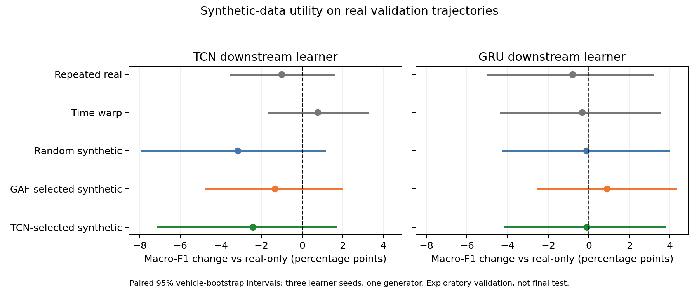

# Downstream utility of training-only trajectory synthesis

Known training-path motion augmentation: one diffusion checkpoint (seed42), 425 training conditions, eight candidates each; one selected sample per condition. No validation trajectory is used as an augmentation condition. Real downstream data: 1,437 train / 164 validation, six classes. Synthetic extras cover five classes, no pedestrians. Final test untouched.

Six groups use fixed 1,150 updates of 64 uniform-with-replacement draws. Normalization and class weights are frozen from real training data. Three fresh learner seeds 100/101/102, TCN and bidirectional GRU. No selector weights reused. All augmented groups have the same 425 extra labels and parent conditions; repeat/timewarp control the changed class frequency.

| Learner | Training group | Macro-F1 % | Accuracy % | Delta F1 vs real-only pp [paired 95% interval] |
|---|---|---:|---:|---:|
| tcn | real_only | 74.46 +/- 1.17 | 79.27 +/- 1.32 | 0.00 [0.00, 0.00] |
| tcn | repeat | 73.45 +/- 1.23 | 79.07 +/- 0.29 | -1.00 [-3.53, 1.57] |
| tcn | timewarp | 75.22 +/- 1.13 | 80.28 +/- 0.76 | 0.76 [-1.64, 3.25] |
| tcn | synthetic_random | 71.27 +/- 3.20 | 78.86 +/- 1.60 | -3.18 [-7.91, 1.11] |
| tcn | synthetic_gaf | 73.13 +/- 2.89 | 78.66 +/- 0.50 | -1.33 [-4.72, 1.98] |
| tcn | synthetic_tcn | 72.02 +/- 0.98 | 78.05 +/- 0.86 | -2.43 [-7.10, 1.64] |
| gru | real_only | 57.21 +/- 2.92 | 69.92 +/- 0.57 | 0.00 [0.00, 0.00] |
| gru | repeat | 56.41 +/- 0.90 | 69.72 +/- 1.04 | -0.81 [-5.00, 3.14] |
| gru | timewarp | 56.89 +/- 0.45 | 70.53 +/- 0.57 | -0.32 [-4.34, 3.48] |
| gru | synthetic_random | 57.10 +/- 2.21 | 70.53 +/- 2.24 | -0.11 [-4.25, 3.93] |
| gru | synthetic_gaf | 58.11 +/- 2.63 | 69.92 +/- 2.74 | 0.90 [-2.52, 4.30] |
| gru | synthetic_tcn | 57.11 +/- 1.98 | 70.12 +/- 2.59 | -0.10 [-4.11, 3.75] |

[PDF figure](utility.pdf)

## Scope and interpretation

Validation counts by class (pedestrian, bus, motorcycle, car, bicycle, taxi): [6, 14, 31, 93, 16, 4]. Small minority classes limit certainty. Intervals condition on one generator checkpoint and a fixed synthesis pool; they do not include generator variation or correct multiple comparisons.

This is validation development, not a final test result or a low-label experiment. Known training paths make this motion augmentation, not novel-route synthesis. The timewarp control uses piecewise interpolation of raw coordinates and is a simple training perturbation, not a separately validated SUMO simulator.

Compare synthetic methods with both real-only and repeat/timewarp controls, and GAF-selected with random synthetic on both learner families. Teacher agreement does not establish downstream gain; report negative results. All selection fallbacks and input hashes are in summary.json.

## Decision

No robust augmentation gain is established. GAF-selected synthesis changes macro-F1 versus real-only by -1.33 pp on TCN and +0.90 pp on GRU; both paired intervals include zero. Versus random synthetic data the changes are +1.85 pp (TCN, interval [-1.33, 5.45]) and +1.01 pp (GRU, [-1.69, 4.27]); these also include zero. GAF does not convincingly outperform the repeat control. The synthesis pool has 99.97% eligible candidates and zero selection fallbacks, so this result is not explained by the earlier audit search-cap artifact.

Preserve this as a bounded validation pilot with one generator and known training paths. Do not initiate gradient-teacher guidance or tune downstream architectures to obtain a favorable score. The next bounded experiment changes route diversity only: current eight candidates share a path and vary motion, while the intended framework permits alternative lawful routes. Freeze all models, K and participant conditions, then test independently sampled candidate paths with the same selectors and audits. This hypothesis does not imply it will improve downstream utility.
