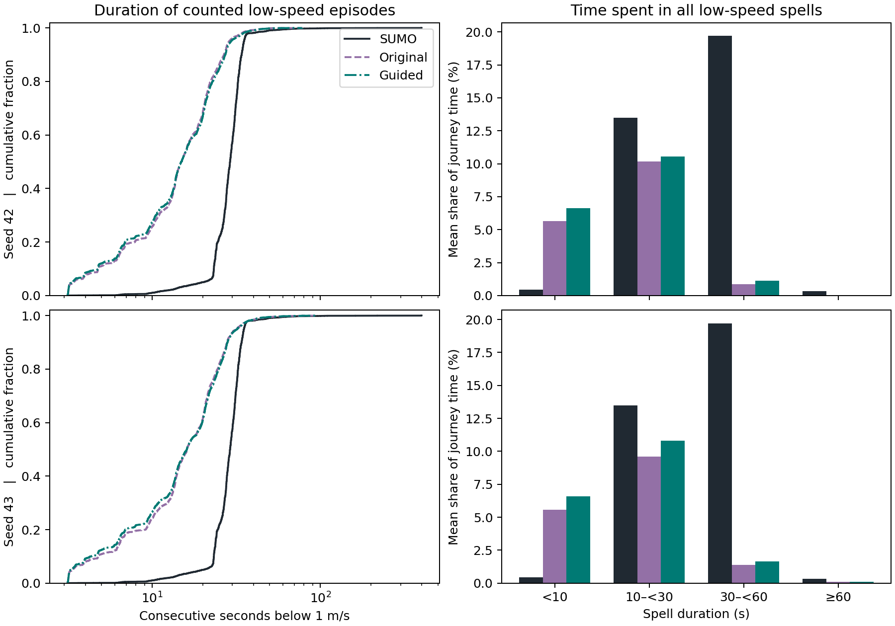
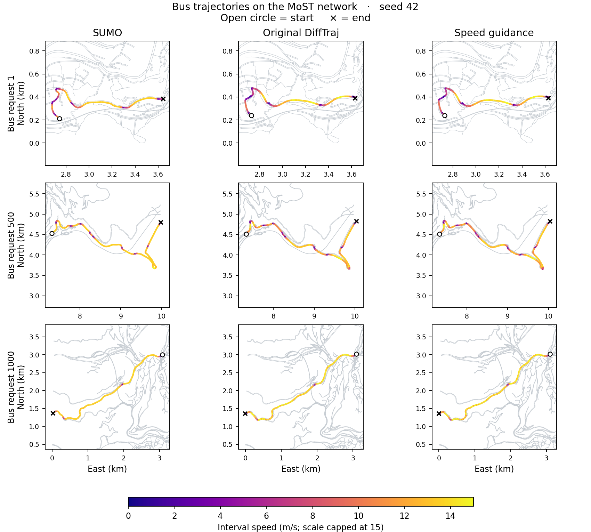

# How long does a generated bus stay slow?

The complete development set contains 1,000 SUMO bus trips. Each observed trip and its paired draws are compared on the same 200-position elapsed-time grid. An episode is a contiguous run of intervals below 1 m/s. To reproduce the previous entry metric, the duration distribution counts runs preceded by a faster interval and lasting at least two intervals. Time-share bars include every slow interval, including initial runs and single-interval dips. Duration quantiles weight episodes equally. Time shares and entry rates weight journeys equally. End-of-trip spells use the observed portion of the spell; excluding them changes the medians by at most 0.1 seconds. These are low-speed episodes; the speed threshold does not establish that a bus served a stop.

| Source | Counted entries / 10 min | Median duration (s) | 90th percentile (s) | Episodes lasting ≥30 s | Journey time in 30–60 s spells |
|---|---:|---:|---:|---:|---:|
| SUMO | 6.93 | 29.01 | 34.04 | 42.4% | 19.72% |
| Original 42 | 6.44 | 14.86 | 26.71 | 3.8% | 0.86% |
| Speed guidance 42 | 7.06 | 14.86 | 27.22 | 4.4% | 1.11% |
| Original 43 | 5.96 | 16.12 | 27.78 | 6.3% | 1.39% |
| Speed guidance 43 | 7.14 | 16.04 | 28.02 | 6.5% | 1.65% |

The time deficit concentrates in 30–60 s spells. Relative to observed trips, guided samples spend more time in spells shorter than 10 s. Previous speed guidance compares quantiles after sorting interval speeds, which removes their temporal order. It can improve the distribution while making little change to the median duration of a slow run.

The maps show the first, 500th and 1,000th bus requests in the release's validation order. The two seeds use identical requests, row extents and a fixed 0–15 m/s colour scale. Straight segments join adjacent positions on the 200-point grid without snapping to roads. The basemap matches the release's network SHA-256. A spatial line compresses long stationary periods to one location.

The simulator source file route/most.buses.flows.xml contains 298 route-stop entries, each configured with duration 30.00 seconds. The dataset generator retains this duration when removing the timetable until attribute. This explains why a concentration around 30 seconds is plausible in this simulation. The analysis measures speed-derived episodes and does not match each event to a transit stop.

## Temporal guidance pilot

At the same frozen checkpoints, fixed requests and initial noises, an additional term compares the frequencies of contiguous 10-, 20- and 30-second low-speed windows against medians from the same 32 training neighbours. The differentiable surrogate uses the maximum interval speed in each window. The original speed-quantile term and the two-metre signal-weighted displacement cap remain active. On all 1,000 development buses the counted median rises from 14.86 to 15.33 seconds and from 16.04 to 16.51. The proportion of counted spells lasting at least 30 seconds rises to 4.97% and 7.24%. The observed proportion is 42.4%. This small improvement on the development set leaves the long-duration deficit in place.
