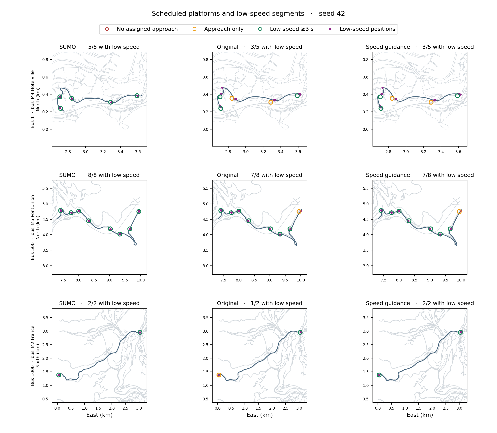
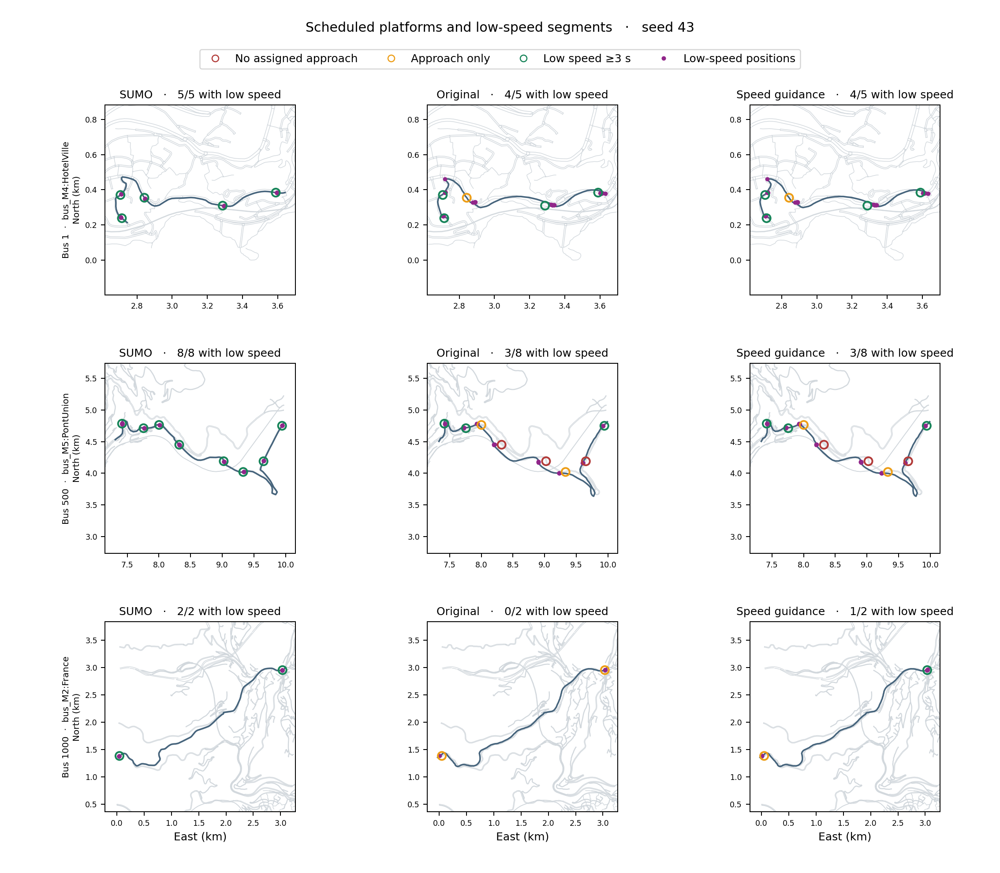

# Scheduled-stop alignment on the complete bus validation set

Each of the 1,000 observed vehicle IDs is joined to its vehicle entry in the corresponding simulation episode's routes.xml, then to the ordered stops of that exact assigned route. The platform geometry is taken from startPos and endPos on its specified lane on the verified MoST network. All methods use identical requested journeys, station lists and comparison rules. Neither the reference line nor its station list was supplied to the original generator.

The primary approach zone is 30 m from the platform polyline. The sensitivity analysis uses 15 and 50 m. Both SUMO and sampled coordinates are evaluated on the same 200-point physical-time grid. A one-second midpoint reconstruction along the 199 linear segments measures distance and assigns that segment's speed. Interpolation does not recover sub-grid dynamics. The alignment assigns contiguous zone visits in route order with disjoint time intervals. It prioritizes the number of approached stops, then the number with at least three consecutive seconds below 1 m/s, then proximity. A visit with less than three slow seconds counts as approach only. Duration is the longest continuous slow spell during the assigned zone visit. Near parallel roads or intersections, spatial proximity can indicate a visit on an adjacent lane or a signal wait. These are inferred service events.

The paired decomposition uses scheduled calls where the SUMO reference satisfies the same low-speed rule. For a generated missed call or pass-through, recognised slow dwell is zero. For calls recognised on both sides the signed shortfall is reference minus generated dwell. This sum concerns recognised station dwell and differs from whole-trip low-speed time. Figures show the first, 500th and 1,000th bus in validation file order, with the same map extent within a row.

## Results

The release contains 10,771 scheduled calls. The primary rule recognises 10,670 reference calls (99.1%). Among these reference calls the following percentages sum to 100% within rounding.

| Sampler and seed | No matched approach | Approach only | Matched low speed | Median recognised dwell on matched calls |
|---|---:|---:|---:|---:|
| Original 42 | 16.9% | 34.9% | 48.2% | 14 s |
| Speed-guided 42 | 17.0% | 33.1% | 49.9% | 14 s |
| Original 43 | 16.1% | 32.4% | 51.6% | 14 s |
| Speed-guided 43 | 16.1% | 30.4% | 53.5% | 15 s |

The paired reference median is 30 s in every row. At 30 m about 22% of the guided dwell shortfall is due to missing the approach, 42–44% to passing without sustained low speed and 34–36% to abbreviated dwell on recognised calls. The partition depends on spatial tolerance: at 15 m the guided recognised call fractions are 27.7/29.0%, and at 50 m they reach 64.3/69.8%. Operational proximity and dwell are separate objectives.

For an explicitly line-conditioned extension, use a requested service and its published ordered platform list. Compare existing speed guidance, ordered platform approach, and ordered approach plus local contiguous dwell, at the same requests and noise. Keep reference timestamps and positions out of the sampling inputs. Include a comparator with the same line information to separate added input information from guidance design. Retain full-trip physical and distribution metrics as well as missed calls, passes and conditional dwell.
