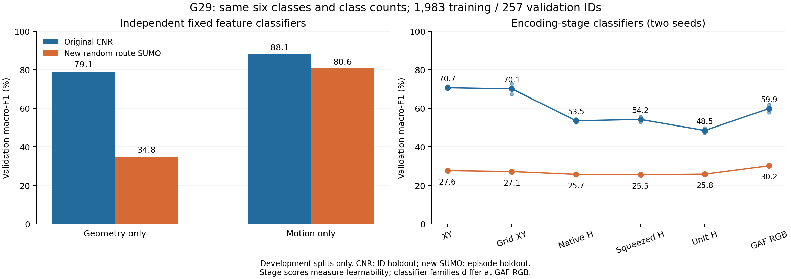

# G29：原 CNR 与新 SUMO 的空间 GAF 差距定位

2026-11-06。依照用户要求先核对数据来源和原编码；本轮没有训练生成器、没有修改论文。全部30个预定分类拟合已完成，以下属于开发集诊断，不能替代独立最终测试。

## 结论

**新 SUMO 没有复现原 CNR 的类别—路线使用结构，是空间识别差距的重要数据分布解释；原编码链路也存在信息损失和读取困难，但不能把约30个百分点的 GAF 来源差距全部归咎于编码。**

这个结论有三条互补证据：未经过 Hilbert/GAF 的 XY 和纯几何分类也大幅下降；新 SUMO 的物理运动特征仍能较好分类；原编码在原 CNR 上可复现约60%的宏F1。扩容改变了研究对象的分布，不能用新随机路线上的低分否定原方法，也不能以原 CNR 的分数证明该方法在固定路线下必然提供运动引导。

## 1. 先排除口径和实现差异

主数据是用户提供的 `midimost_with_class2.csv`，六类为行人、公交、摩托车、私家车、自行车、出租车。另一个原始 `vehicle_positions_TS_New.csv` 的2,189,591条记录只有 `veh_passenger` 一个标签，不能用于多类车型对照。分类器均为本项目自训，没有组内CNN权重。

原E1三组已有权重回放全部269个验证ID，准确率75.7125%、宏F1 60.0947%，与历史保存指标最大差小于3.3×10⁻⁸。预定的每类3条、共18条原始观察重新编码后，与历史RGB缓存逐像素相同。这个正对照使用原来的“全ID观察”；后续主对照改用最长连续段，二者明确区分。

共同六类、每类数量、编码边界、64×64 Hilbert网格、224长度、RGB通道尺度固定。主对照双方各1,983个训练ID、257个验证ID，按类数量分别是 `[611,111,295,751,141,74]` / `[70,14,37,109,18,9]`。这是双方类数相同，**不是六类均衡**。每ID取最长连续0.25秒段，至少5秒。新SUMO来自G22完整到达行程；原CNR没有原始到达记录，不能把它的全ID观察称为已证实的完整行程。

每个学习输入固定50轮、两个训练种子，使用最后一轮，不按验证集挑选。1D各组使用同一两通道CNN；单通道Hilbert补零。图像使用与E1同规则的ImageNet ResNet18。主对照20次、512点图像4次、时长匹配图像2次，加量化坐标控制4次，共30次。无生成训练、无调参扫描；冻结测试未用于训练、选型或评价。

## 2. 差距在进入 GAF 之前已经出现

下表是验证宏F1。几何/运动特征分类器为预先固定的非线性分类器，XY和GAF为两个种子的均值。

| 输入与读出 | 原CNR | 新SUMO |
|---|---:|---:|
| 纯路线几何：位置、形状、等弧长占据 | 79.12% | 34.85% |
| 原XY序列、同架构1D CNN | 70.66% | 27.63% |
| 原Hilbert→GASF/GADF/MTF RGB、ResNet18 | 59.88% | 30.15% |
| 物理运动特征：速度、加速度、停留等 | 88.08% | 80.57% |

几何支没有输入时间或显式速度；运动支是另一个诊断，不冒充空间GAF结果。固定线性分类器也得到同方向：几何62.28%→28.26%，运动82.72%→72.19%。因此该来源差距不依赖某一种图像网络。

新SUMO GAF的训练宏F1为99.52%，验证只有30.15%；原CNR为99.13%与59.88%。这组结果说明训练集拟合已经充分，继续追求训练准确率本身解决不了泛化问题。它不构成所有架构均已达到最优的证明。

### 原空间结构具体少了什么

G22仿真代码 `scripts/g22_sim.py` 给车辆设置 `vClass`，然后在许可路网上随机规划行程。它没有设置公交线路和站点停靠需求，也没有恢复原CNR的类别条件OD/路线使用频率。

仅用32个等弧长XY点寻找最近训练路线：原CNR宏F1为71.19%，新SUMO为27.90%。原CNR公交验证轨迹13/14最近邻同类，新SUMO只有1/14；公交与最近同类训练路线的RMS中位数由0.243米变成417.98米。汽车最近邻同类由98/109变成48/109。1毫米容差内完全重复路线均为0%，不将同类近似路线复用等同于完全重复样本泄漏。

共同16×16网格上，类别平均路线占据的类间Jensen–Shannon散度均值为0.2760→0.1156 bits；公交—汽车0.2475→0.0839，汽车—出租车0.4653→0.0992。新数据的空间类别分布更重叠。

训练侧公交轨迹的时长中位数906.5→201.0秒，轨迹平均速度的中位数5.04→10.30 m/s，停止比例中位数39.75%→0%。停止定义是原生相邻坐标速度低于0.3 m/s；中位数为0不表示所有车辆都从不停留。时长匹配后，新SUMO公交仍是9.75 m/s、停止比例中位数0%。公交的停留/低速运动分布也未被原样保留；仅凭这些坐标不能判断原公交是否在站点停靠。

所以应区分：**新数据仍有车型运动信号，但这些信号及其与位置/路线的联系不等同于原CNR。** 新数据运动分类中，公交F1仍为93.33%，汽车92.86%，出租车则为0%；不能以总分掩盖出租车差异很弱。

## 3. 编码链路里发生了什么

下面每列来源内部使用完全相同的训练/验证ID，各阶段为验证宏F1的双种子均值：

| 输入 | 原CNR | 新SUMO | 能支持的解释 |
|---|---:|---:|---|
| XY重采样224点 | 70.66% | 27.63% | 原坐标基线 |
| 同一Hilbert格子的二维中心坐标 | 70.09% | 27.14% | 单独网格量化在本协议下影响较小 |
| 原生Hilbert标量序列重采样224点 | 53.52% | 25.70% | 非线性标量表示、插值及CNN读取共同变化 |
| 原squeeze/duplicate后的Hilbert序列 | 54.21% | 25.48% | 未观察到相对原生Hilbert读出的额外大幅下降 |
| 每条Hilbert序列再min–max到[0,1] | 48.47% | 25.81% | 原CNR绝对Hilbert范围被去掉，读取分数进一步下降 |
| 原GASF/GADF/MTF RGB图像 | 59.88% | 30.15% | 改为2D预训练网络，不能与上一行当作同架构损失量 |

Hilbert在网格单元上可逆；把二维坐标换成标量再插值会改变表示与学习难度。因此70.09%→53.52%不能直接解释为“Hilbert删除了16.57个百分点的信息”。该标量CNN原CNR训练F1也只有58.21%，明显包含读出/优化限制。

继承的 `squeeze` 根据相同数值连续段的长度比例压缩，并从长段移除重复值，保留每个连续段至少一个值；它不是简单删掉全部驻留。短序列 `duplicate` 镜像补长。它们会改变时间表示，但本轮Hsqueeze读出没有比Hraw明显更差，不支持将squeeze单独认定为主因。

每轨min–max会去掉Hilbert序列的绝对偏移和范围，是明确的不可逆步骤。原CNR点估计下降5.74个百分点，但配对95%区间为[-12.97,+1.28]，尚未建立稳定的分类性能损失；不能把分差当作普适的信息量。单独网格量化差为-0.57个百分点[-3.14,+1.50]，squeeze相对原生Hilbert为+0.70[-2.19,+3.62]。Hilbert范围不是米制行程或运动幅度。

确定性细分复核：所有十个来源/窗口/划分的squeeze都保留了全部有序网格访问run及唯一格子支持，最终224点H与缓存逐值一致。主验证集镜像补长比例CNR22.96%、SUMO6.61%；512点均不补长。压缩前后每run相对驻留份额的总变差均值，主验证集为0.03886/0.02060，512点为0.01337/0.01533。压缩改变时间分配，但本批数据没有删掉已访问run。坐标越界裁剪为CNR 1/440,107点、SUMO 174/209,411点，通道裁剪均为零。

GASF本身对已经归一化到[0,1]的序列满足 `u_i = sqrt((G_ii+1)/2)`。主验证集浮点对角恢复平均MAE为CNR 1.71×10⁻¹⁵、SUMO 1.73×10⁻¹⁵；uint8恢复平均MAE为0.002652、0.003394。这说明当前GASF数值实现没有把该归一化序列大规模破坏，**不意味着能还原原始XY或真实时间**。

主验证集常量Hilbert序列比例为CNR15.56%、SUMO7.39%，全是行人；原生唯一格子数中位数23/13。常量表示未跨过约156×97米的网格，不等于停车。新SUMO没有更高的常量图比例。因此“新数据多数轨迹量化成常量导致低分”不符合这批数据。

## 4. 时长控制、迁移与不确定性

主图像来源差CNR减SUMO为29.72个百分点，95%区间[22.49,36.87]。双方都取512个原生点（127.75秒），按类重新匹配，训练1,120、验证147个ID；图像宏F1仍为CNR50.93%、SUMO31.82%，来源差19.11个百分点[8.38,29.72]。

全观察/连续长段与512点的资格人口不同。限制到双方各自全部147个共同验证ID，长段模型宏F1为CNR66.97%、SUMO26.38%，窗口模型50.93%/31.82%。这个比较消除了验证ID不同，训练人口和输入跨度仍一起变化，不能解释为纯时长因果效应。

同数量下按类最小化log时长差选择SUMO记录，GAF宏F1为32.57%，纯几何36.68%。匹配仍有严重支持不足：训练公交CNR时长中位数906.5秒，对应SUMO382秒；汽车597.25秒对应190.75秒，汽车验证典型配对仍差约2.11倍。不能声称已完全消除了时长混杂。

原CNR是单份导出的按ID留出，新SUMO是按整场留出。来源差距包含真实分布差异、路线重复结构与划分难度差异，不能据此给“数据问题”和“编码问题”划定因果百分比。公交验证14、出租车9，512点出租车仅4，逐类统计尤其不稳定。

`summary.json`保存所有30组的指标、混淆矩阵、来源迁移和区间。区间按类别分层重采样车辆ID2000次；相同来源/同人群/同种子的表示比较成对抽样，跨来源分别抽样，两个固定种子先各算F1再平均。区间条件于这些已拟合模型与开发划分，不代表新地图/新仿真场次或训练随机性的完整不确定性；未作多重比较校正。固定特征分类器表中为点估计。

## 5. 对后续生成研究的约束

1. 把原CNR作为源数据基准，新随机路线SUMO作为另一分布的压力对照。此前G28低空间分数及引导失败，不能泛化为原CNR方法没有价值。
2. 修正扩容的需求模型，先在原CNR训练侧分析类别条件的观测段起终点（OD代理）、路线使用、时长、停留及速度分布；观测段首尾不能直接当作真实出发地和目的地。公交线路/停站需求应有独立依据，坐标停留也可能来自交通等待。保留共用道路、类内变化和类间重叠，不能人为给每类划专属区域来制造高分类分数。原CNR没有完整SUMO需求文件，重建只能称近似，必须披露来源和误差。
3. 在同类数、原空间编码下重新核验新数据，并按仿真场次及路线是否见过分别报告泛化。空间分支只能读坐标表示，速度分支单列；二者都应比较原始CNR和新仿真。
4. 再决定GAF连接生成器的层级：空间GAF若主要读出路线与地理分布，就应检验它对路线选择/空间覆盖的反馈；固定同一路线的运动生成主要检验速度GAF及空间图中剩余的时序信息。不能要求只调整沿固定路线的速度去弥补缺失的车型路线结构，也不能用分类分数代替物理质量。

本轮到数据诊断为止。先保留原始结果、修正数据协议，再开展有限的新生成对照；论文保持原版本，待新证据成立后重写其适用范围。

## 6. 复现与实现记录

协议：`docs/G29_PROTOCOL.md`。入口：`g29_prepare.py`、`g29_run.sh`、`g29_grid_run.sh`；独立审计及汇总：`g29_structure.py`、`g29_positive.py`、`g29_encoding_detail.py`、`g29_summarize.py`、`g29_figure.py`。服务器隔离目录 `g29-job`。原数据、预测ID和权重只保留本地/服务器；仓库仅保存代码、聚合指标、来源哈希和图。

量化坐标控制审查发现，原Hilbert递归在精确网格边界上的取侧规则不能普遍用全局floor替代，已改为原Hilbert索引反查格中心。在本轮实际5,665,391个原生点上，两者不同点为0；修正后所有已有grid_xy逐元素一致，因此四组已完成模型仍有效，无需重训。合成网格边界反例与实际数据核验分开记录。

一次手动复核命令遗漏vendor路径，触发导入失败；补全与正式队列相同的PYTHONPATH后通过。正式队列及30个完成标记均核验。没有因结果方向新增训练配置或选择最佳种子。
