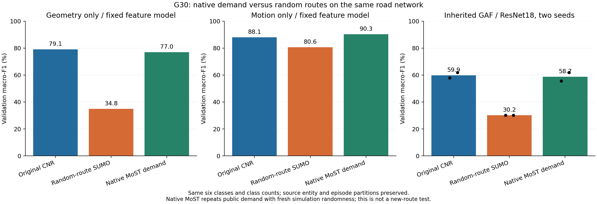

# G30：原生需求恢复了大部分空间分类结构，也改善了运动分布

状态：**完成，开发诊断；未新增生成器训练，未修改论文。** 2026-11-06。完成标记、六个模型槽位、全部训练/验证保存预测与24组跨来源预测均已核验。分类是识别读出，物理距离是新仿真与 CNR 的接近程度，本报告均不是扩散合成质量结果。

本轮回答 G29 留下的关键问题：先前随机路线 SUMO 没有保留原 CNR 的类别—空间结构。接入同图的官方原生需求后，在不改变编码与分类训练预算的情况下，GAF 宏 F1 从30.15%回到58.69%，接近原 CNR 的59.88%；纯几何读出也从34.85%回到76.95%。因此，先前空间低分不能主要凭直觉归咎于 GAF 或 CNN。该对照支持需求域不匹配这一解释，但不能分解路线、停站、交通密度与活动链各自的因果贡献，也不证明编码或网络已无改进空间。

## 1 来源、范围与防泄漏

公开来源固定为 [MoSTScenario b29b2f65f1096a9c69a601ec62a724815cb4a43f](https://github.com/lcodeca/MoSTScenario/tree/b29b2f65f1096a9c69a601ec62a724815cb4a43f)，使用 `scenario/in` 与配套 `most.sumocfg`。网络 SHA256 为 `a06b5c0765fb2d49d4ad33cf54048f15f2ff1592b2b3d0180dbeec4feb73bfc0`，与现用网络逐字节一致。原生需求有24条公交线路/流、181个公交站点，以及停车、活动链、多模态换乘和背景车流。**没有用户原仿真的配置文件，不能称原 CNR 完整复现。** 输入计划和最终实现路线分别审计。

SUMO1.28.0；兼容性 pilot300001 不进入模型/指标队列。正式6训练场次300101–300106、3开发场次300201–300203全部完成。固定14400–19516秒、0.25秒步长，该观察范围由 CNR 训练侧时间范围确定。九场只是同一公共需求的新仿真随机实现，不是九份独立新 OD。每个实体保留最长连续观察段（至少5秒），不是宣称其整天行程或完整 OD；到达和截尾信息另存。

实际类型按官方 vClass/type 映射共同六类，uber 显式映射为出租车，moped 不悄悄合并到摩托车，其他类别仅为背景。乘车 person 记录从行人观察中排除；步行与等待仍在 on-foot 观察里。九场未知类型均为0。跨场得到25,185条合格实体观察、3,054个 base ID；重复随机实现只取一个固定哈希排名的合格记录，不按标签、时长或分数选。

已知 CNR base ID 继承原 train/val 划分；原测试模板269个全部排除（只读既有ID/split元数据，没有读取旧测试轨迹、标签或结果）。未知实体才按固定哈希划分。实体和仿真场次分区同时满足才纳入，CNR训练→native验证及反向的已知ID交叉均为0。没有进行逐坐标全库近复制审计，所以不声称不存在相似/重复轨迹。

三来源均为**1,983训练、257验证**，类别数量完全相同：

| 类别 | 训练 | 验证 |
|---|---:|---:|
| 行人 | 611 | 70 |
| 公交 | 111 | 14 |
| 摩托车 | 295 | 37 |
| 私家车 | 751 | 109 |
| 自行车 | 141 | 18 |
| 出租车/网约车 | 74 | 9 |

native 与 CNR 的验证共有204个实体（79.4%），共同部分标签204/204一致；其中14公交、18自行车、9出租车全部共享。因此属于同需求模板的来源恢复检查，不能称独立需求外部验证。区间对跨来源同实体使用相同 Exp(1) 权重，2000次 Bayesian bootstrap，seed30055；物理分布距离按来源与类别归一化；分类直接对加权混淆矩阵重算指标，类别先验随权重变化，不是固定类数量的分层区间。区间条件于现有实体、固定模型、线路和少量仿真种子，没有多重比较校正，也不覆盖新城市、新线路或模型训练随机性。

native验证中187条机动车有最终路线元数据，其中44条最终路线在训练见过；公交14/14都见过，12条验证线路均在训练24条线路中。行人70条没有此最终车辆路线hash，不能把缺失算未见路线。这进一步限制了新路线泛化的表述。

## 2 固定分类与跨来源检查

保持 G29 冻结的空间边界、64×64网格、224点序列、原 Hilbert squeeze/补长及 GASF/GADF/MTF RGB 编码。这里的“GAF”是继承的三通道图片管线，不是只有单张 GASF。没有给空间 CNN 额外喂速度。纯几何与物理运动另用固定 HistGradientBoosting 读出（100轮，无提前停止，类别平衡权重），用于区分数据中存在的空间/运动信号，不是可互换的模型性能上界。

GAF 采用相同 ResNet18、固定50轮末轮、种子42/43，不选择最佳epoch或最佳种子。CNR/random 的队列与逐字节编码缓存均与 G29 相同，核验后复用4个旧权重；本轮只新增2个 native 拟合。所有 CNN 是本项目自行训练，没有组内原分类器。

| 验证宏 F1 | 原 CNR | 随机需求 SUMO | 原生 MoST 需求 |
|---|---:|---:|---:|
| 纯空间几何固定读出 | 79.12% | 34.85% | 76.95% |
| 物理运动固定读出 | 88.08% | 80.57% | 90.35% |
| 原 Hilbert–GAF 自训 ResNet18 | 59.88% | 30.15% | 58.69% |

native 两个 GAF 种子为55.56%、61.82%；原 CNR平均准确率74.12%，random58.17%，native73.35%。native−random宏F1差 **+28.54pp [21.03,35.98]**；CNR−native差 **+1.19pp [−4.40,6.84]**。相近不等于已证明统计等效，未预设等效界。

| GAF 每类 F1，两种子均值 | 原 CNR | 随机需求 SUMO | 原生 MoST 需求 |
|---|---:|---:|---:|
| 行人 | 92.69% | 90.72% | 81.92% |
| 公交 | 75.07% | 0.00% | 76.86% |
| 摩托车 | 45.64% | 10.72% | 52.81% |
| 私家车 | 80.57% | 62.80% | 83.78% |
| 自行车 | 43.86% | 8.33% | 33.92% |
| 出租车/网约车 | 21.43% | 8.33% | 22.86% |

公交空间识别恢复，出租车与自行车仍弱；native训练宏F1约99.70%、验证58.69%，仍有明显泛化差距。不能把平均回升写成“分类器已足够准确，可以放心guidance”。

下面冻结各来源已训的模型，直接换验证来源，数值均为两种子宏 F1：

| 训练来源 → 验证来源 | 原 CNR | 随机需求 SUMO | 原生 MoST 需求 |
|---|---:|---:|---:|
| 原始 CNR | 59.88% | 30.05% | 55.89% |
| 随机需求 SUMO | 28.76% | 30.15% | 28.71% |
| 原生 MoST 需求 | 58.05% | 28.01% | 58.69% |

**不重训的 CNR 模型对 native 为55.89%，对 random为30.05%。** native模型对 CNR 为58.05%。这支持域结构恢复，而非仅换一个更会拟合新数据的网络；仍受共有需求模板与线路影响。

## 3 运动分布：不是只把分类分数做高

所有值来自同样257个验证实体/来源；用坐标弧长在统一1秒时钟计算速度与加速度，然后逐轨提取统计量。表中是各类别统计量分布到 CNR 的一维 Wasserstein距离，再对六类等权平均；**越低越接近 CNR**。不是单条轨迹预测误差，也不是多个不同单位指标混为一个总分。停止阈值为0.3m/s；平稳段沿用G23/G28规则 `v≥0.3且相邻秒速度差<0.5m/s`；四秒变速不再除以4。

| 分布指标 | random到CNR W1 | native到CNR W1 | native−random与95% Bayesian区间 |
|---|---:|---:|---:|
| 最长平稳段（s） | 34.872 | 22.259 | -12.613 [-25.962, -7.017] |
| 观察段时长（s） | 262.581 | 62.173 | -200.408 [-257.682, -159.097] |
| 四秒速度变化绝对值均值（m/s） | 0.429 | 0.233 | -0.196 [-0.369, -0.111] |
| 每轨平均速度（m/s） | 2.844 | 0.828 | -2.017 [-3.181, -1.155] |
| 平均绝对加速度（m/s²） | 0.132 | 0.074 | -0.058 [-0.107, -0.034] |
| 停止比例（0–1） | 0.135 | 0.028 | -0.107 [-0.120, -0.081] |
| 每轨速度95分位（m/s） | 1.841 | 1.111 | -0.730 [-2.213, +0.175] |
| 最长停止段（s） | 57.938 | 22.398 | -35.540 [-50.028, -19.612] |
| 停止段数/分钟 | 0.350 | 0.149 | -0.200 [-0.232, -0.126] |
| 观察段弧长（m） | 1436.234 | 182.964 | -1253.270 [-1636.496, -976.051] |

十个预定物理终点的宏平均点估计全部改善，九项差区间低于零；95分位速度的区间跨零。逐类并非全好：**行人观察时长、最长停留和弧长的距离分别恶化140.56秒、42.66秒和91.94米，三者区间都在零以上**。新的 on-foot 观察含等待及活动阶段，而原CNR表格的记录规则不能完全恢复。摩托车/私家车若干速度指标也有恶化点估计，完整逐类值保留于 `quality.json`。

训练侧公交分布提供易理解的检查（每轨统计量的类别中位数，与上表验证分布距离不同）：

| 公交训练中位数 | 原 CNR | random | native |
|---|---:|---:|---:|
| 平均速度 m/s | 5.041 | 10.305 | 5.042 |
| 停止比例 | 39.51% | 0.00% | 40.80% |
| 观察段时长 s | 906.50 | 201.00 | 906.75 |

原生需求恢复了停走/巡航和时长分布，远比仅随机一条“公交许可路线”接近原CNR。这里的停止来自1秒坐标速度，不能把所有低速都解释为站点服务，也不能将整个改善单独归因于站点设置。

## 4 对生成主线的实际决策

现在有依据修正实验的数据基础：空间 GAF 在带真实运营结构的需求域中有可读出的车型相关信息；先前随机路线域的弱空间分数不能代表其在原 CNR 域无用。速度与空间信息仍需分别检验，不能用分类成功替代生成有效性。

下一步先完成 [G31完整行程接口](../../G31_LEG_INTERFACE.md)：车辆活动停车切分、公交整条服务、行人完整 walk stage，保留途中停站和真实时间，验证输入计划路径与实际轨迹及表示重构。活动链中截出的观察段不可直接喂给目前完整OD生成器。用源计划或预先规划路径作生成条件，最终FCD/exitTimes/priorEdges只作监督审计。

之后才能锁定生成实验：空间表示优先检验候选路线/空间覆盖上的增量，速度表示检验给定合法路线上的运动模式增量；保留经验迁移、无GAF、同预算筛选及打乱反馈对照，主判断仍是物理分布、多样性与拓扑合法性。这个分工是由本轮证据引出的**待检验假设**，尚无新的guidance优势结论。没有向论文新增负结果或把本轮分类提升改写为扩散提升。

## 5 可复现记录与失败

协议：`docs/G30_PROTOCOL.md`。代码：`scripts/g30_native.py`、`g30_extract.py`、`g30_demand_audit.py`、`g30_prepare.py`、`g30_quality.py`、`g30_fit.py`、`g30_summarize.py`、`g30_figure.py` 与有限队列 `g30_run.sh`。服务器隔离目录 `/workspace/cnr-experiments/gaf-inloop-v1/g30-job`；最终队列标记 `g30-data/cohort-complete.txt` 已核验。模型执行代码以聚合 `execution-receipts.json` 文件哈希为准；图表代码另见Git记录。

首次服务器获取公开源文件超时发生在仿真前，原 `pilot-queue.log` 保留；改本机按固定提交获取、逐文件大小/哈希核验后传入，第二次pilot成功，正式九场均完成。正式场次summary共记8次teleport，日志关键词计数3/5/7是行数而非事件数。原生teleport/重路由配置未更改；连续段提取既按时间缺口，也按坐标速度超过100m/s断段，但没有按teleport事件剔除整个实体，也不检查逐段道路连接，不能保证保留队列完全无异常影响。原日志及回执保留，成功退出不等于每个实体都无异常。G30不覆盖旧输出或旧工作树。

本目录仅保存代码相关引用、聚合指标、混淆矩阵、来源和输出哈希、图表。原数据、完整轨迹、ID清单、逐样本预测及权重保留服务器/本机隔离目录，不推Git。`prepared.json`含选择和覆盖，`demand-audit.json`含公开需求结构，`quality.json`含全物理分布/区间，`summary.json`和`transfer.json`含全部模型指标。
