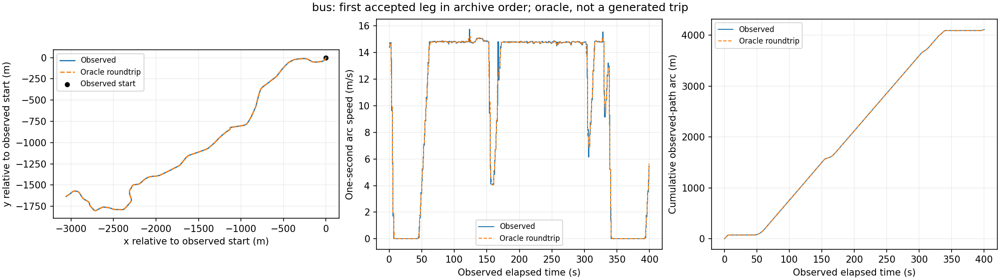

# G31：完整行程能提取，但长时序与地图路径接口还需适配

2026-11-06，**有限接口检查已完成；生成接口尚未就绪，没有训练模型、没有修改论文。** 该单场pilot不进入G30分类或新的生成评价。G30已说明原生需求能恢复空间类别结构，本轮防止将其观察段直接误当完整行程，并检查现有整程表示是否保留运动细节。

主要结果：在相同pilot上仅增加输出字段，新旧9,939,409条记录的共同字段完全一致。按真实事件提取了1,644段、来自1,592个parent ID的完整观测出行段。静态地图检查暴露换道/步行路径适配缺口；即使用真实目标构造空间路径，257点时间进度仍会平滑较长行程的运动。这是训练前的数据接口证据，不是GAF或扩散生成实验的新负结果。

## 1 输出无扰动与失败保留

原生MoST来源、网络、SUMO1.28.0、seed300001、14400–19516秒与0.25秒步长保持G30 pilot一致；仅增加exitTimes、未结束stop、priorEdges、routeLength、路线历史与FCD pos输出。重放152.31秒完成，未再次随机OD。20,464个时刻、9,939,409条实体记录的`x,y,type,speed,lane/edge,vehicle`及嵌套关系逐项完全一致，共同字段语义SHA256均为`584e9ac0a9026a134e0d7be8175f8b5a52495ceb80a35c64a512392dc28d150b`。

首次比较程序将辅助字段非有限值当作致命错误，158.61秒中止。实际有1,600条person speed=NaN，新增pos有1,601条person NaN。修复只将speed/pos缺失分类计数，不填零、不更改原字段；坐标和时间仍强制有限，原字符串仍严格比较。保留首次失败，只重跑检查到attempt2，八项构造检查通过；不重做仿真。

重放没有teleport/collision记录，日志警告50行，仍不据此宣称所有XY运动都无异常。后续覆盖检查还拒绝了15条>100m/s坐标跳跃段。

## 2 用事件定义行程，而非按观察ID或低速随意切段

普通车辆从出发或活动停车结束，到下一活动停车开始或最终到达；公交保留中间站点停靠，把一次完整服务视为一段；行人只取完整walk stage，骑乘person不重复计作步行。活动边界来自公开需求停车语义和仿真事件，不来自分类分数或人为低速阈值。

增强输出1960个stop有started/ended，其中513尚未结束；1654个walk stage都有起止字段，其中994未结束。因此“整天活动链没结束”不等于“没有任何完整前段”。原测试模板按parent先排除，同parent的多段不跨分区。这个pilot全体输出中的270个模板排除与G30合格连续段队列的269不是相同分母。

1659个事件候选，15个坐标跳跃拒绝（公交4、汽车11），最终1644。包含3个不足5秒的短段，未按时长删掉；没有常量段。所有观测起点与事件起点相同，1123段最后FCD比事件终点早0.25秒、521段相同，没有猜补精确终点坐标。

| 类别 | 段数 | parent数 | 观测时长中位数s | 最长观测s |
|---|---:|---:|---:|---:|
| 行人 | 593 | 541 | 161.00 | 1070.50 |
| 公交 | 93 | 93 | 1054.50 | 2354.50 |
| 摩托车 | 269 | 269 | 335.25 | 1073.50 |
| 私家车 | 507 | 507 | 636.00 | 1162.50 |
| 自行车 | 106 | 106 | 370.25 | 1091.25 |
| 出租车/网约车 | 76 | 76 | 227.62 | 608.00 |

1592个parent中1541个单段、50个双段、1个三段，额外52段全部为步行stage。parent互异也不等于统计独立：仍共享同场交通与公共需求。覆盖报告里的source_link_counts是4065个类型/测试过滤后parent级，不是1644段的计数。

**语义纠正保留：**原执行回执的`vehicle_vaporized=714`全部实际为SUMO `vaporized="end"`，表示仿真截止未完成，不能称714次异常销毁。小XML事后核验中，26公交有途中站停但整服务未完成，688个非公交没有任何活动停车事件，未发现遗漏的已完成普通车前段。本pilot结果无需因此重提取；原始回执不覆盖，解释与后续修复另记`semantic-clarification.json`。后续代码已允许end-parent保留已完成前leg，15项构造测试通过；它未重跑真实数据，不能将旧真实结果归给新代码。

## 3 预定路径与实际轨迹严格分列

1595段有公开源计划的显式边序列：93公交完整服务、909普通车唯一活动段、593walk；49段只有OD（5摩托、44汽车），需要仿真前规划，不能以最后输出的路线补成条件。本pilot没有重复边无法唯一切分的实际纳入案例。

源计划与实现边序列1507相同、88不同、49无源完整边序列。88不等中78个parent有rerouteNo>0，10个没有，不能把88全部解释为重路由。实现序列只作审计，不替换源计划；没有按该相等性筛掉候选。flow的来源关联通过最后路线/line或端点核验，因此本诊断队列的覆盖仍带目标相关选择；后续正式生成请求不能直接复用这层筛选。

地图检查仅读取公开计划、source vType与固定网络。分清每条边有可用lane、相邻边有连接、全程能保持连续lane链三件事；第三列需要换道表示不代表SUMO路线非法。

| 类别 | 静态连续lane链且接缝≤2m | 相邻边合法但需换道适配 | 步行方向/区域待适配 | 仅OD需预先规划 |
|---|---:|---:|---:|---:|
| 行人 | 0 | 0 | 593 | 0 |
| 公交 | 35 | 58 | 0 | 0 |
| 摩托车 | 110 | 154 | 0 | 5 |
| 私家车 | 158 | 305 | 0 | 44 |
| 自行车 | 75 | 31 | 0 | 0 |
| 出租车/网约车 | 37 | 39 | 0 | 0 |

合计415段静态链有支持、587段需换道适配、593段为步行专用适配、49段需先规划。**415也不是正式生成可用数量**：起止位置、站点lane顺序、横向运动和真实目标到计划路径的投影尚未联合验证。此处没有将车辆有向连接规则硬套给双向步行，也没有把无横向连接的路线误报为非法。

## 4 原257点时间进度的重构误差

直接导入未修改的`g22_diffusion.positions/decode`。使用真实目标坐标构造2049个等弧长空间点、257个等相对时间进度点（float32），再按0.25秒解码。真实路径用于此oracle检查，不是生成时可用的输入；不是所有可能表示的数学下界，也不能证明计划地图解码正确。另保留原始时间进度、仅离散空间路径作为path-only位置对照。

位置误差在原生0.25秒观察时刻比较；速度、加速度与运动状态使用统一1秒坐标弧长时钟。表内先对每段计算时序MAE，再在类别中汇总；“速度MAE p95”是每段MAE的95分位。短段几何保留，速度/加速度/四秒变化所需的最短支持分别计数。三个时长不足5秒样本不被隐去：速度、加速度与巡航状态各有2段支持，四秒变速没有满足支持条件的段。

| 类别 | 仅空间路径位置MAE均值m | 完整表示位置MAE均值m | 速度MAE均值 / p95 m/s | 加速度时序MAE均值m/s² | 巡航状态不一致均值 |
|---|---:|---:|---:|---:|---:|
| 行人 | 0.0013 | 0.0154 | 0.0237 / 0.0529 | 0.0393 | 1.16% |
| 公交 | 0.0164 | 0.7676 | 0.4237 / 0.8581 | 0.4460 | 21.06% |
| 摩托车 | 0.0190 | 0.2006 | 0.2478 / 0.4658 | 0.4039 | 10.91% |
| 私家车 | 0.0297 | 0.2878 | 0.2668 / 0.4434 | 0.3968 | 12.62% |
| 自行车 | 0.0048 | 0.0565 | 0.0766 / 0.1418 | 0.1287 | 6.87% |
| 出租车/网约车 | 0.0102 | 0.0911 | 0.0930 / 0.2759 | 0.1526 | 4.43% |

| 观测时长 | 段数 | 位置MAE均值m | 速度MAE均值m/s | 加速度MAE均值m/s² | 巡航状态不一致均值 |
|---|---:|---:|---:|---:|---:|
| <5秒 | 3 | 0.0001 | 0.0001 | 0.0001 | 0.00% |
| 5–<60秒 | 94 | 0.0042 | 0.0068 | 0.0114 | 0.47% |
| 60–<300秒 | 573 | 0.0366 | 0.0483 | 0.0810 | 2.54% |
| 300–<900秒 | 873 | 0.2101 | 0.2178 | 0.3404 | 10.44% |
| ≥900秒 | 101 | 0.8765 | 0.5155 | 0.5465 | 24.02% |

总体位置MAE均值0.178m看似小，但每段最大位置误差的95分位达10.265m，全体最大29.337m；最大逐秒速度绝对误差13.819m/s。≥900秒的101段，速度MAE均值0.515m/s，巡航状态不一致平均24.0%。仅空间路径的位置MAE均值0.0144m、公交0.0164m，加入时间压缩后为0.178m、0.768m，支持时间分辨率是重要瓶颈；没有把差值解读为可精确相减的全部物理误差贡献。

公交中位观察1054.5秒，257结点的间隔约4.12秒；最长间隔约9.20秒。公交停止比例均值37.58%→34.39%，四秒变速1.636→1.497m/s。总体均速只差−0.0089m/s、弧长相对差平均约−0.198%，但逐段平均绝对加速度的样本均值从0.425440降至0.363124m/s²，相对下降14.65%；这是两个样本均值的比值，不是逐段相对降幅的平均。**仅看里程/均速会遗漏运动模式被平滑的问题。**

最长巡航指标也会放大阈值附近的变化：行人速度MAE均值仅0.0237m/s，最长巡航绝对误差却均值25.36秒、p95为158.25秒。该指标须结合逐秒误差、状态不一致与其他分布指标，不能单独决定质量。全部十个物理量的signed/absolute误差、分位数与短段支持在`roundtrip.json`，没有只保留好看的指标。

## 5 固定示例与下一步

各类只取归档顺序首段，已逐图视觉核验；不代表典型或最差样本。图展示真实观测与oracle重构，**不是扩散生成样本**；细节在缩略图中接近不代替全体长尾指标。

其他固定首段：[汽车](first-private_car.png)、[摩托](first-motorcycle.png)、[自行车](first-bycicle.png)、[出租车](first-taxi_or_uber.png)、[行人](first-pedestrian.png)。

下一轮生成实验之前需要两项具体适配：把公开路线/OD与可解码的路网走廊、停站、换道及步行接口接通；在完整长行程上使用与物理时间对应的时序表示，并先通过同样的重构检查。不删掉长行程，不因某个阈值指标不利而放宽评价。可以先对固定物理时钟的变长表示作有限无训练检查，再锁定新扩散对照。这里不预先承诺某一新表示或GAF组合一定有效。

GAF主线保留：在G30验证过的原生需求域中，检验空间表示对路线/空间分布、速度表示对路线内运动的增量；仍需无GAF、等预算筛选与独立物理评价。当前结果不能倒推历史所有guidance负结果都源于257点，也不能把空间分类恢复当作已证明guidance成功。论文仍未改。

执行工作树为`/workspace/cnr-experiments/gaf-inloop-v1/g31-job`，`g31-data/interface-complete.txt`与全部分阶段回执已回读。回执包含实际代码/来源哈希；新增代码、8项输出检查、13项初版leg检查、5项路径检查和重构自测已归档。原始FCD、源计划、ID清单、leg NPZ与逐条路径结果留服务器，不进入Git。
