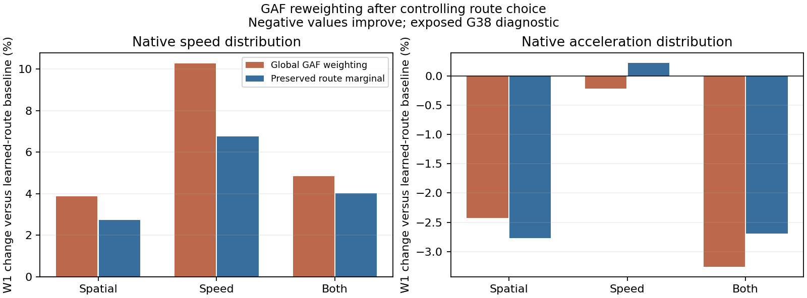

# Route-marginal mechanism diagnostic

Completed on the four already-exposed G38 scene/model-seed cells. No new fitting or trajectory generation. The old R and all three global-GAF results match exactly, including every class and endpoint.

| Rule | Speed W1 | Δ vs R | Acceleration W1 | Δ vs R | Road-edge JS |
|---|---:|---:|---:|---:|---:|
| R | 1.167275 | +0.00% | 0.171918 | +0.00% | 0.034577 |
| Global-S | 1.212469 | +3.87% | 0.167744 | -2.43% | 0.037324 |
| FixedRoute-S | 1.199110 | +2.73% | 0.167157 | -2.77% | 0.034577 |
| Global-V | 1.287111 | +10.27% | 0.171554 | -0.21% | 0.036263 |
| FixedRoute-V | 1.246243 | +6.77% | 0.172298 | +0.22% | 0.034577 |
| Global-SV | 1.223677 | +4.83% | 0.166319 | -3.26% | 0.034730 |
| FixedRoute-SV | 1.214190 | +4.02% | 0.167289 | -2.69% | 0.034577 |

Lower distances are better. Means weight each class, scene and model seed equally. Expected road usage is unchanged for FixedRoute by construction; it is a control check, not an achieved model improvement.

Spatial GAF retains a small aggregate acceleration improvement after route-marginal preservation, but speed still worsens. Speed-GAF feedback still worsens speed and now slightly worsens acceleration. Each fixed-route GAF variant improves acceleration in only2of4 scene/seed cells; the aggregate gain is not stable across scenes. Therefore route marginal distortion is only part of the problem. The data do not establish a broad GAF benefit.

Duration still varies within each route, so this cannot yet attribute the acceleration effect to changed motion at fixed T. The preregistered expanded route×prior-duration×noise experiment addresses that question. It must use the same expanded pool for every method.

Two simulator scenes, shared public templates, four model/scene cells: no independent-four-scenes or unseen-city claim. All adverse results and all per-class physical endpoints are retained in all-metrics.csv. The ongoing G39 train-time alignment study is separate and has no completed generation result yet.

