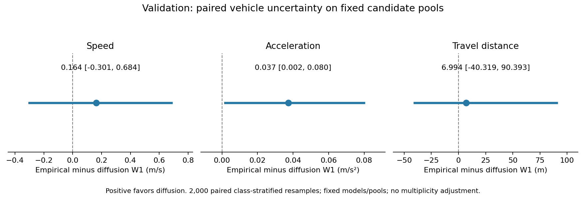

# Motion uncertainty and training-copy diagnostics

All saved K=8 candidates; no selection or resampling of generated trajectories. 2,000 class-stratified vehicle bootstrap draws are shared across generators, all three fixed seeds, and metrics. Each vehicle retains its full candidate pool and real reference. Exact empirical-CDF W1, no histogram approximation. Test untouched.

| Metric | Diffusion | Empirical | Empirical minus diffusion [paired 95% interval] |
|---|---:|---:|---:|
| speed_w1_mps | 1.0183 | 1.1824 | 0.1641 [-0.3007, 0.6841] |
| acceleration_w1_mps2 | 0.2170 | 0.2543 | 0.0373 [0.0017, 0.0799] |
| travel_w1_m | 145.7288 | 152.7231 | 6.9944 [-40.3192, 90.3934] |

Positive differences favor diffusion. Intervals condition on saved models, paths and pools; they do not cover training variability or correct exploratory multiple comparisons. Only 33 vehicles, including three taxis, constrain inference.

## Motion-domain nearest training profiles

Same-class, full 511-step arc increments aligned in time. Near-copy tolerance is mean absolute difference <= 0.001m per increment, fixed before running. Uncapped intended progress is audited, so route truncation cannot hide a copied profile. Shape distance divides each profile by its own mean. These are diagnostics, not a proof of absence of memorization.

| Population | Seed | Median nearest increment MAE m | Near-copy % | Median normalized shape MAE |
|---|---:|---:|---:|---:|
| route-diverse-e4r | 42 | 0.486426 | 0.00 | 0.2014 |
| route-diverse-e4r | 43 | 0.529572 | 0.00 | 0.2070 |
| route-diverse-e4r | 44 | 0.529979 | 0.00 | 0.2252 |
| empirical-motion-e3b | 42 | 0.000000 | 100.00 | 0.0000 |
| empirical-motion-e3b | 43 | 0.000000 | 100.00 | 0.0000 |
| empirical-motion-e3b | 44 | 0.000000 | 100.00 | 0.0000 |
| real_validation_reference | reference | 0.246854 | 0.00 | 0.1149 |

Empirical motion is the known-copy positive control. A low copy rate for diffusion rules out only this narrow aligned-neighbor criterion, not shifted, warped, partial or other forms of memorization. Real references are evaluation-only; their future motion is never given to synthesis. No new GAF usefulness claim follows from this audit.

## Paired effect figure

[Vector PDF](paired_w1.pdf)
