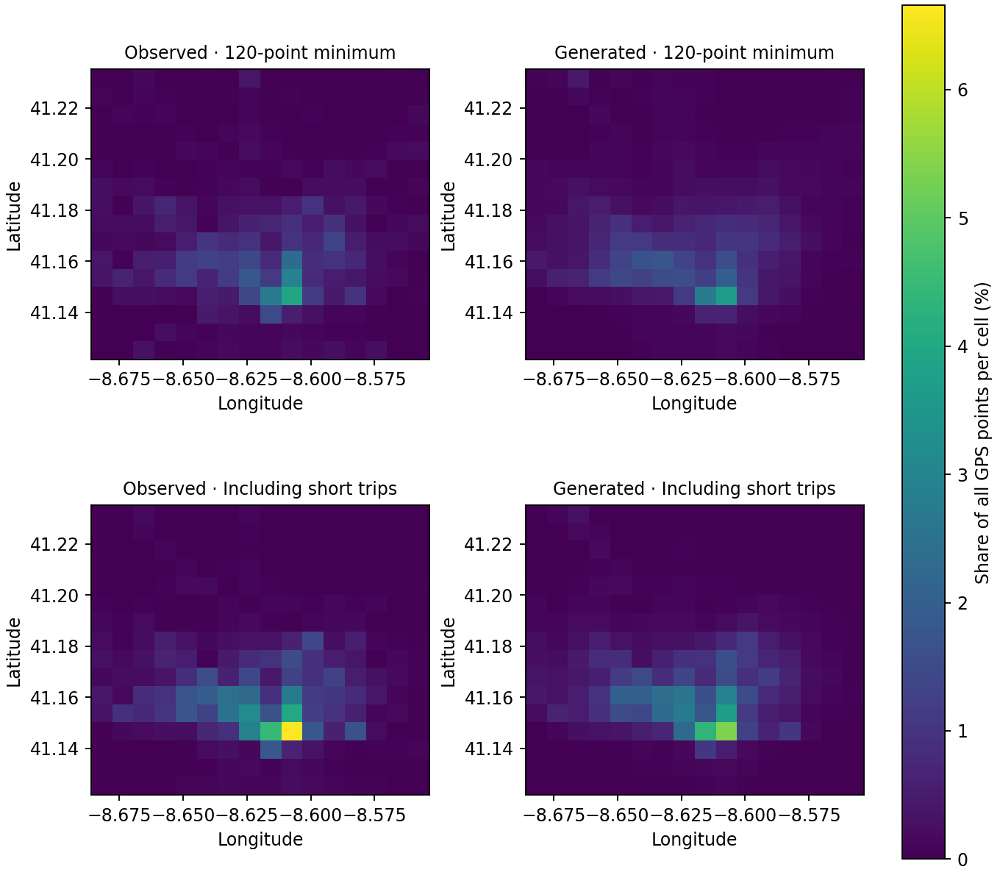
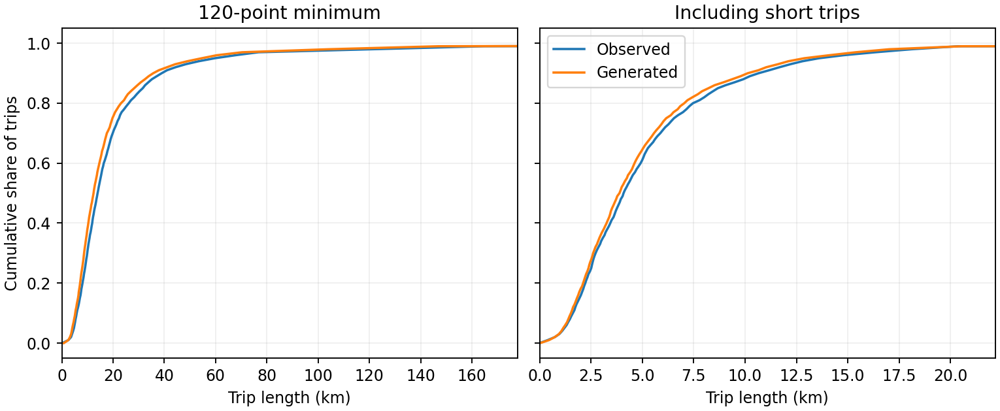

# Porto matched reproduction results

Each row uses 3,000 conditional requests. Both model arms use identical observed coordinates in each evaluation population, verified by content hashes. The mixed training cohort supplies one shared city-core grid and length binning. The appendix reports different, incompletely specified Porto settings (published density .0087, trip .0132, length .0242, pattern .847).

| Seed / train → evaluation | Density JS ↓ | OD JS ↓ | Length JS ↓ | Top-20 F1 ↑ | Length W1 (km) ↓ | Median observed / generated (km) |
|---|---:|---:|---:|---:|---:|---:|
| 42-long-on-long | 0.02462 | 0.38498 | 0.00589 | 0.75 | 2.279 | 13.96 / 12.39 |
| 42-long-on-mixed | 0.02719 | 0.40879 | 0.04955 | 0.70 | 1.349 | 4.08 / 5.62 |
| 42-mixed-on-long | 0.02886 | 0.40086 | 0.00352 | 0.75 | 3.756 | 13.96 / 12.86 |
| 42-mixed-on-mixed | 0.01680 | 0.34243 | 0.00179 | 0.80 | 0.442 | 4.08 / 3.88 |

## Benchmark scores under the historical per-arm grids

| Source | Density JS ↓ | OD JS ↓ | Length JS ↓ | Pattern ↑ |
|---|---:|---:|---:|---:|
| Published Table 5 | .0087 | .0132 | .0242 | .847 |
| 42-long-on-long | 0.01357 | 0.00594 | 0.00635 | 0.75 |
| 42-mixed-on-mixed | 0.01416 | 0.00202 | 0.00179 | 0.45 |

The local historical grids and bins come from each training arm. The shared city-core table above holds their physical scale fixed. The exact published boundaries, bins, n, and Porto sample selection have not been identified.

## Same-size controls

Twenty disjoint random half-splits of the 3,000 real trips, 1,500 per group. Entries are medians over splits. Real versus generated uses matched requests and thus shares conditioning information. Observed versus observed estimates within-cohort variation over trips, without separating vehicles.

| Seed / train → evaluation | Real/real hotspot F1 | Real/generated hotspot F1 | Real/real length W1 (km) | Real/generated length W1 (km) |
|---|---:|---:|---:|---:|
| 42-long-on-long | 0.85 | 0.75 | 1.370 | 2.287 |
| 42-long-on-mixed | 0.90 | 0.70 | 0.318 | 1.341 |
| 42-mixed-on-long | 0.85 | 0.75 | 1.370 | 3.827 |
| 42-mixed-on-mixed | 0.90 | 0.80 | 0.318 | 0.472 |

## Interpretation

The mixed reference occupied only 17 full-grid cells. Ranking 20 cells admits zero counts, with ties resolved by cell index. Its core-grid reference occupied 227 cells. At seed 42 the mixed model scores .45 on the historical full grid and .80 on the city core. On the same core, two independent halves of real trips overlap at .90. Physical length error persists although quantile-bin length JS is small.

On the same mixed requests, training with short trips reduces physical length W1 from 1.349 to 0.442 km at seed 42. On long requests the long-trained model has smaller W1 (2.279 versus 3.756 km) although mixed training gives lower JS. JS summarizes bin mass while W1 also measures the distance moved in kilometres.

The planar-distance sensitivity uses the same metre-valued bins. Across the four seed-42 pairs the largest absolute JS shift from great-circle length is 0.00003.

The heatmaps use the mixed-training core, longitude and latitude axes, and one colour scale across all panels. Length curves interpolate empirical percentiles, with the horizontal display limited to the central distribution. Full-distribution scores include the tails.

See [measurement protocol and sources](PROTOCOL.md) and the per-arm aggregate JSON records for full-grid scores, overflow, and split quantiles.
