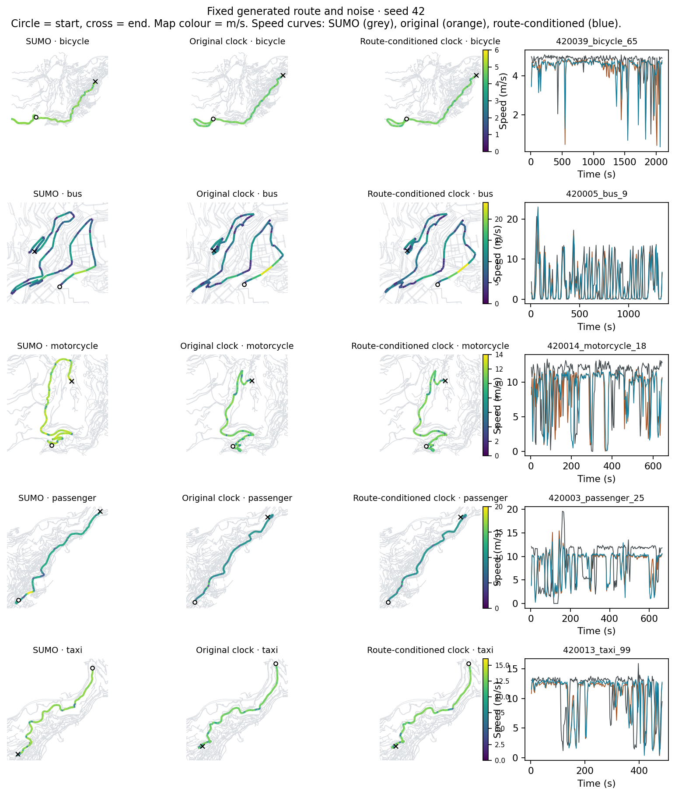
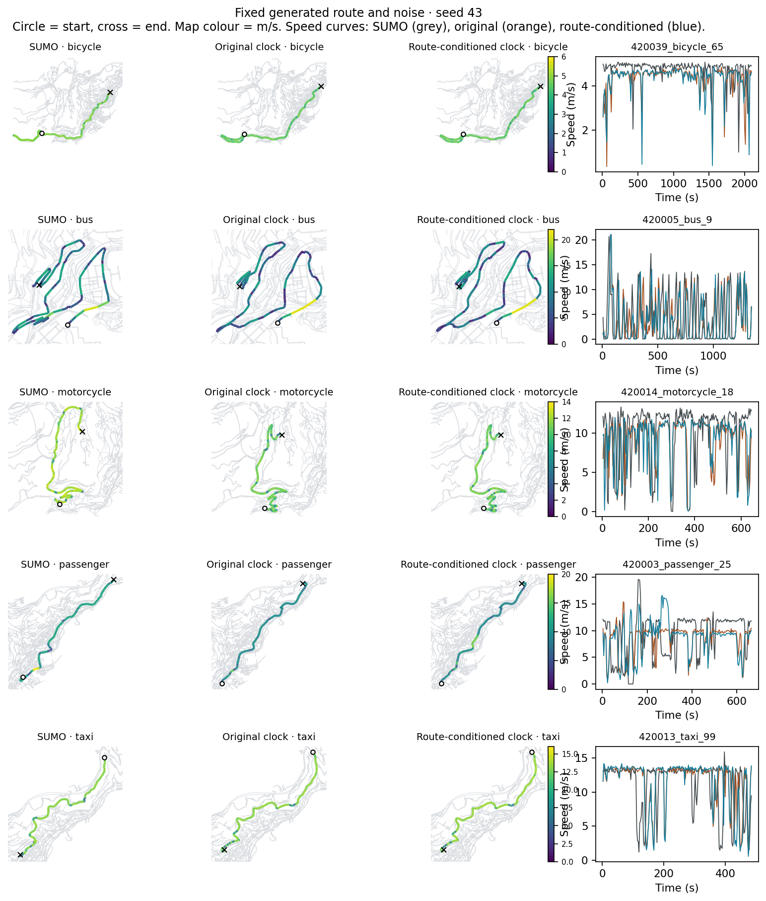

# Can route-conditioned speed diffusion improve the final trip?

Two seeded velocity fits received the length and distance-ordered turn angles of routes sampled by frozen coordinate models. The tables compare timing on the same sampled route, with the same request and noise. All velocity and acceleration measurements use the final positions after retiming. Each cell gives the original → route-conditioned clock. The third column reuses the exact set of coordinate routes in the first column.

| Measure | Seed 42, routes 42 | Seed 43, routes 43 | Seed 43, routes 42 |
|---|---:|---:|---:|
| Speed W1 (m/s) | 0.7929 → 0.7924 | 0.6265 → 0.6292 | 0.7908 → 0.7925 |
| Acceleration W1 (m/s²) | 0.0433 → 0.0450 | 0.0428 → 0.0417 | 0.0450 → 0.0445 |
| Requested destination hit | 71.7% → 71.7% | 70.5% → 70.5% | 71.7% → 71.7% |
| Both requested cells hit | 54.6% → 54.6% | 51.7% → 51.7% | 54.6% → 54.6% |
| Mean within-trip speed W1 (m/s) | 1.1506 → 1.1630 | 1.0715 → 1.0776 | 1.1534 → 1.1571 |
| Class-average absolute mean-speed bias (m/s) | 0.7436 → 0.7424 | 0.5583 → 0.5575 | 0.7425 → 0.7423 |
| Median absolute speed-clock rescaling | 6.1% → 6.0% | 5.2% → 5.1% | 6.5% → 6.3% |
| Density JS | 0.0083 → 0.0083 | 0.0081 → 0.0082 | 0.0083 → 0.0083 |
| OD JS | 0.2357 → 0.2357 | 0.2448 → 0.2448 | 0.2357 → 0.2357 |
| Length JS | 0.0391 → 0.0382 | 0.0355 → 0.0356 | 0.0385 → 0.0379 |
| Hotspot F1 | 0.930 → 0.930 | 0.940 → 0.930 | 0.930 → 0.930 |

## Speed error by vehicle

| W1 (m/s) | Seed 42, routes 42 | Seed 43, routes 43 | Seed 43, routes 42 |
|---|---:|---:|---:|
| bicycle | 0.476 → 0.475 | 0.382 → 0.381 | 0.472 → 0.472 |
| bus | 0.532 → 0.529 | 0.474 → 0.476 | 0.529 → 0.531 |
| motorcycle | 1.020 → 1.019 | 0.795 → 0.798 | 1.022 → 1.024 |
| passenger | 0.975 → 0.980 | 0.732 → 0.734 | 0.976 → 0.978 |
| taxi | 0.963 → 0.959 | 0.748 → 0.756 | 0.955 → 0.957 |

## Change only the vehicle label, keeping each route fixed

The simulated reference uses 53 similar bus–bicycle trip pairs with requested mean-speed gaps at most 0.5 m/s. Both generated labels are applied to both requests, each at its own unchanged route and noise. Earlier exploratory label swaps permitted a different route when changing the label; the original clock was re-scored here under the fixed-route rule.

| Bus minus bicycle (matched SUMO difference) | Seed 42, routes 42 | Seed 43, routes 43 | Seed 43, routes 42 |
|---|---:|---:|---:|
| Low-speed time (pp); SUMO +39.62 | +25.99 → +24.45 | +25.06 → +24.79 | +25.03 → +24.73 |
| Low-speed entries / 10 min; SUMO +7.87 | +5.41 → +5.00 | +5.10 → +5.07 | +5.06 → +5.10 |
| 90th-percentile speed (m/s); SUMO +7.38 | +4.86 → +4.62 | +4.70 → +4.75 | +4.61 → +4.61 |

[Training and matching protocol](PROTOCOL.md)

[Seed 43 on seed-42 routes](common-routes-42/map-43.png)
