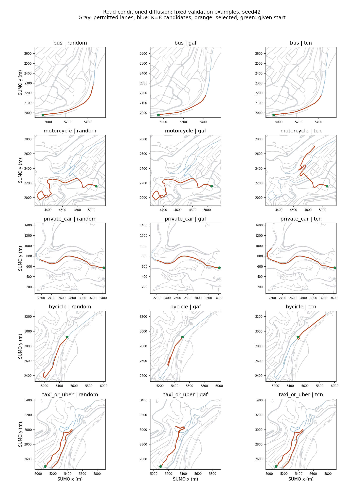

# Long trajectory diffusion and original GAF candidate selection

Three diffusion seeds, 20,000 updates each, 512 points (127.75 s), five moving non-pedestrian classes. 425 training / 57 available validation tracks; generation uses 33 selected validation conditions and K=8 draws each. Planned validation paths use only start, class and the training-only transition prior. Test untouched.

All selection methods use the same candidate pool and shared validity mask. Teacher seed42; auditors seeds43/44. GAF uses inherited Hilbert/squeeze/GASF/GADF/MTF, with duration-matched self-trained ResNet18. The raw trajectory TCN uses the same real training cohort and 50 epochs. Different network families and ImageNet initialization are disclosed, not claimed to be identical architectures.

| Method | Graph consistency % | GAF audit % | Raw TCN audit % | Speed W1 m/s | Acceleration W1 m/s2 | Route cap % |
|---|---:|---:|---:|---:|---:|---:|
| all_candidates | 100.00 +/- 0.00 | 42.47 +/- 0.94 | 76.11 +/- 0.80 | 1.02 +/- 0.09 | 0.22 +/- 0.01 | 0.00 +/- 0.00 |
| random | 100.00 +/- 0.00 | 37.22 +/- 2.75 | 76.94 +/- 1.96 | 1.00 +/- 0.03 | 0.20 +/- 0.01 | 0.00 +/- 0.00 |
| gaf | 100.00 +/- 0.00 | 63.33 +/- 1.18 | 72.78 +/- 3.42 | 1.13 +/- 0.18 | 0.25 +/- 0.01 | 0.00 +/- 0.00 |
| tcn | 100.00 +/- 0.00 | 56.67 +/- 2.04 | 91.94 +/- 4.16 | 1.12 +/- 0.14 | 0.25 +/- 0.00 | 0.00 +/- 0.00 |
| shuffled_gaf | 100.00 +/- 0.00 | 31.39 +/- 2.75 | 75.56 +/- 6.17 | 1.21 +/- 0.10 | 0.23 +/- 0.01 | 0.00 +/- 0.00 |

## Representation and coverage diagnostics

Lane candidate search limit per point: 64. All methods use the previously established search limit; this experiment resamples paths while freezing models.
- Seed 42: valid candidates 1.000; identical GAF pools 0.000; mean distinct images per eight draws 8.00; candidate-pair distance 147.62 m; encoding failures 0.
- Seed 43: valid candidates 1.000; identical GAF pools 0.000; mean distinct images per eight draws 8.00; candidate-pair distance 147.02 m; encoding failures 0.
- Seed 44: valid candidates 1.000; identical GAF pools 0.000; mean distinct images per eight draws 8.00; candidate-pair distance 146.67 m; encoding failures 0.

## Interpretation limits

Road consistency belongs mainly to the path decoder, not to GAF. Same-family auditor agreement can favor its selector; inspect both families and motion distributions. Real-reference auditor accuracy is recorded in summary.json and each seed report to expose evaluator limitations. A high classifier score is not synthetic-data utility.

Taxi has only three evaluation conditions, motorcycle six. Seeds share these conditions and are not independent vehicles; mean/std is descriptive, not a statistical significance test. Full-trajectory and short-window historical experiments are different populations. Each condition produces one selected sample, so retained within-condition diversity is not established; only original candidate-pool diversity is reported.

Next decision must combine independent class agreement, motion realism, selection fallback and image distinguishability before downstream augmentation. Preserve negative findings and assess broader route coverage; do not expand classifier architecture search.

## Route-motion candidate experiment

This is a post-E5 route-diversity experiment, not another search-cap sensitivity run. Each candidate has an independently planned path, using the same training-only prior and 4096m budget. Generator checkpoints, participant conditions, K=8, classifier checkpoints and initial DDIM noise are frozen. Compare with long-selection-e4-cap64; no new classifier or diffusion training.

- Seed 42: mean distinct paths 6.70/8; planning fallbacks 0; route caps 0.000.
- Seed 43: mean distinct paths 6.70/8; planning fallbacks 0; route caps 0.000.
- Seed 44: mean distinct paths 6.70/8; planning fallbacks 0; route caps 0.000.

## Decision after inspection

Route diversity raises candidate-pair distance from approximately 62–67m to 147m while preserving all observed graph checks. It does not establish retained diversity after selection. Relative to random selection in this new pool, GAF audit accuracy rises from 37.22% to 63.33%, but raw TCN audit falls from 76.94% to 72.78%, and speed W1 rises from 1.00 to 1.13m/s. This does not support a cross-family improvement. TCN selection has the same-family advantage too; its 91.94% TCN audit is not evidence of synthetic-data utility. These percentages are class-macro accuracies, not macro-F1.

Preserve the E5 negative utility result. Do not start GAF proxy-gradient training on this evidence. The remaining generation-specific question is whether learned motion diffusion improves over transferring empirical training motion to the same routes; this comparison has not yet been run. Test remains untouched.

## Fixed map examples

Seed42, first condition of each class, fixed before viewing images; no cases chosen by quality. Blue lines show all candidates, orange shows each selection. No real future is supplied to the generator.

[Vector PDF](map_examples.pdf) · [Selection record](map_examples.json)
