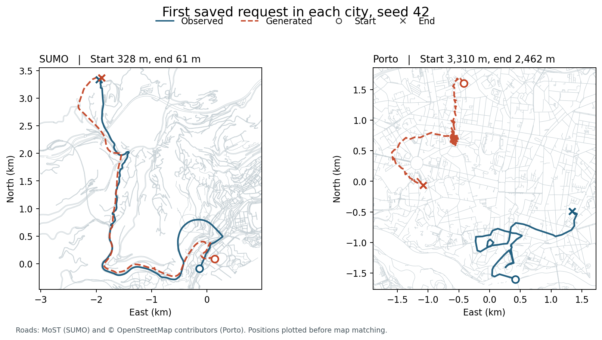

# Do the saved conditional DiffTraj draws follow a requested trip?

Two independently fitted seeds (42 and 43) each generated 1,000 trips per city. The corrected-departure SUMO/MoST taxi models and the Porto long-trip models each trained on 10,000 trips. The SUMO requests are development trips; Porto uses reserved taxi trips. Both seeds see the same requests in the same order within their city. Each model was given an origin cell and a destination cell along with its other trip information. Comparisons in metres use the coordinates of the observed realization associated with each request. No coordinates were snapped before calculating distribution scores or endpoint errors.

## Request-level errors

| City | Seed | Median start / end error (m) | P90 start / end error (m) | Requested cell hits for start / end / both | Both ends within 500 m | Both requested cells and a continuously supported trip |
|---|---:|---:|---:|---:|---:|---:|
| SUMO | 42 | 295 / 321 | 637 / 661 | 49.7% / 46.4% / 24.7% | 615/1,000 | 2/1,000 |
| SUMO | 43 | 319 / 309 | 645 / 651 | 48.0% / 45.6% / 22.6% | 659/1,000 | 0/1,000 |
| Porto | 42 | 2,828 / 3,827 | 6,351 / 11,017 | 94.1% / 91.4% / 87.2% | 2/1,000 | 2/1,000 |
| Porto | 43 | 3,013 / 5,008 | 6,903 / 12,528 | 92.4% / 88.5% / 83.9% | 0/1,000 | 0/1,000 |

The requested 16-by-16 grid uses training-set extrema in each city. Each SUMO cell is approximately 623 m east–west by 393 m north–south. A Porto cell is about 17 km by 25 km at the latitude of Porto. A several-kilometre error can therefore lie inside the requested Porto cell. Model inputs specify cells. Two legitimate trips fulfilling a request could use different exact endpoints or roads. Original grid scoring clips overflow to the outer cell. Strict in-bounds joint hits for SUMO change to 245 and 225; Porto is unchanged. [Endpoint ledger and definitions](endpoints/README.md)

## Directed-road support

Every source includes 1,000 trips. Interval percentages pool intervals over trips. Middle denotes an interval whose midpoint falls within the central 80% of elapsed time. A trip passes when every evaluated interval admits a consistent directed route under the city-specific matcher. The speed screen also requires every interval's matched route distance divided by elapsed time to stay at or below 40 m/s.

| City and source | Connected intervals | Connected middle intervals | Entire middle connected (trips) | Entire trip connected (trips) | Entire trip connected and speed-compatible (trips) |
|---|---:|---:|---:|---:|---:|
| SUMO observations | 99.77% | 99.77% | 935 | 922 | 910 |
| SUMO generated, seed 42 | 64.52% | 66.60% | 16 | 5 | 4 |
| SUMO generated, seed 43 | 62.56% | 64.42% | 8 | 1 | 0 |
| Porto observations | 89.61% | 88.74% | 707 | 650 | 489 |
| Porto generated, seed 42 | 58.79% | 58.10% | 7 | 2 | 2 |
| Porto generated, seed 43 | 50.10% | 49.78% | 2 | 0 | 0 |

Both matchers use a 50 m search tolerance and observations spaced 15 seconds apart, with SUMO retaining its terminal point. SUMO uses taxi-permitted directed edges and turns on the original simulation road network, with a primary limit of 16 candidate edges per point and a bounded network detour between observations. Increasing the cap to 32 gives 934 observed and 6 / 3 generated whole trips passing. At the denser 200-point model resolution all observed SUMO interior positions were within 10 m of a taxi lane; for the two seeds the generated shares were 41.1% / 41.8%. [SUMO matcher configuration and counts](../taxi-road-quality/sumo/summary.json) · [Candidate sensitivity](../taxi-road-quality/sumo/candidates32.json)

Porto uses Valhalla with taxi costing on an archived OpenStreetMap extract that postdates the GPS campaign. The full denominator includes out-of-extract trips and all matching failures. Among trips entirely inside the extract, 650/951 observed and 2/937 or 0/943 generated trips passed. The Porto and SUMO matchers differ, and Porto trips have many more intervals. Interpret generated and observed rates within each city. The audit accepts alternative connected routes, and a failure indicates that the chosen matcher could not support every interval. [Porto road protocol and results](../taxi-road-quality/porto/README.md)

## Four DiffTraj distribution metrics

| Cohort | Density JS ↓ | OD JS ↓ | Length JS ↓ | Hotspot F1 ↑ |
|---|---:|---:|---:|---:|
| Published Porto, Table 5 | .0087 | .0132 | .0242 | .847 |
| Local Porto, seed 42 | .0295 | .0205 | .0065 | .700 |
| Local Porto, seed 43 | .0372 | .0227 | .0109 | .550 |
| SUMO, seed 42 | .0191 | .4166 | .0193 | .750 |
| SUMO, seed 43 | .0130 | .4156 | .0237 | .800 |

Local scores replay the original saved draws using the full training grid, 20 training length-quantile bins and top-20 hotspot overlap. All four values matched the archived scores of each model. Table 5 is a published reference. Its exact Porto evaluation sample and histogram construction were not documented. [DiffTraj Appendix C.1](https://arxiv.org/html/2304.11582#A3.SS1)

## What a draw looks like

The examples use the first saved request in both cities at seed 42, chosen by position in the saved array. Circles mark origins and crosses mark destinations. Each panel has its own labelled kilometre axes. Line segments connect successive positions. The displayed paths retain their original coordinates. Map attribution for Porto: © OpenStreetMap contributors. [OpenStreetMap license](https://www.openstreetmap.org/copyright)

The data support two distinct findings. In the SUMO cohort the generator localized both ends within 500 m on most requests, while only a small number of complete sampled trips could be supported by the directed road network. In Porto, large endpoint cells produced frequent cell hits even with kilometre-scale errors. Within both cities, road breaks persisted through the middle of the journey. [4,000 paired trip records](paired-trips.csv) · [Joint success counts](paired-counts.json)
