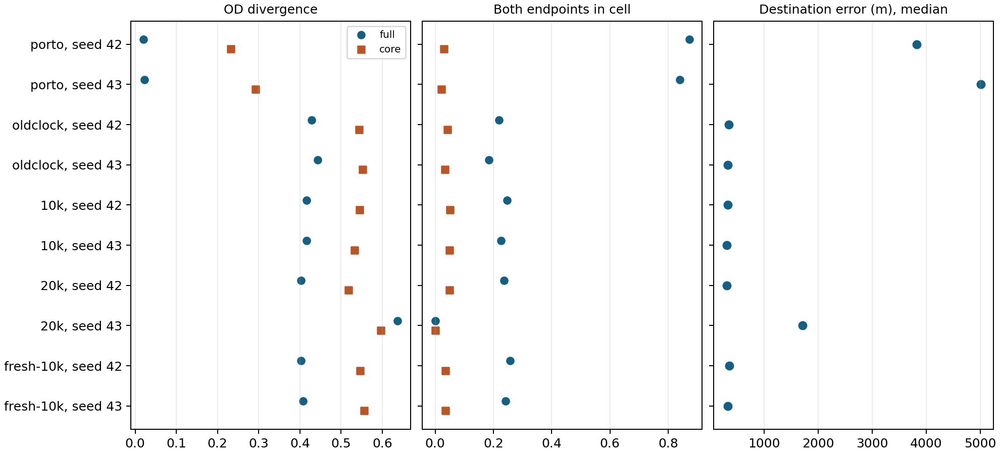

# Independent taxi diagnostics

The 10k SUMO training normalization domain supplies common scoring bounds and length bins for comparisons among SUMO fits. The Porto 10k training data supply their own physical bounds and bins. All evaluation points are restored to their original per-trip sample counts before computing occupancy or length. Native scores preserve each model’s own training bounds. Real-coordinate SHA-256 hashes refer to ordered, decoded float64 positions and trip lengths. Equal hashes identify identical reference trips in identical order. The source JSON includes bounds, length-bin edges, overflow, marginals, distance error percentiles and spot checks.

| Model | Seed | Requests | Common grid | Density JS | OD JS | Length JS | Hotspot F1 | Origin / dest JS | Exact OD hit | OD within one cell |
|---|---|---:|---|---:|---:|---:|---:|---:|---:|---:|
| porto | 42 | 1000 | full | 0.0295 | 0.0205 | 0.0065 | 0.700 | 0.0071 / 0.0134 | 87.2% | 98.5% |
| porto | 42 | 1000 | core | 0.0327 | 0.2328 | 0.0065 | 0.850 | 0.0371 / 0.0710 | 3.1% | 43.5% |
| porto | 43 | 1000 | full | 0.0372 | 0.0227 | 0.0109 | 0.550 | 0.0048 / 0.0156 | 83.9% | 98.2% |
| porto | 43 | 1000 | core | 0.1214 | 0.2929 | 0.0109 | 0.600 | 0.0885 / 0.1303 | 2.2% | 39.0% |
| oldclock | 42 | 1000 | full | 0.0227 | 0.4284 | 0.0209 | 0.750 | 0.0433 / 0.0512 | 22.0% | 95.0% |
| oldclock | 42 | 1000 | core | 0.0231 | 0.5433 | 0.0209 | 0.800 | 0.0621 / 0.0726 | 4.3% | 57.8% |
| oldclock | 43 | 1000 | full | 0.0169 | 0.4436 | 0.0386 | 0.800 | 0.0532 / 0.0428 | 18.4% | 89.1% |
| oldclock | 43 | 1000 | core | 0.0167 | 0.5524 | 0.0386 | 0.850 | 0.0628 / 0.0739 | 3.3% | 57.0% |
| 10k | 42 | 1000 | full | 0.0191 | 0.4166 | 0.0193 | 0.750 | 0.0436 / 0.0493 | 24.7% | 95.5% |
| 10k | 42 | 1000 | core | 0.0187 | 0.5448 | 0.0193 | 0.800 | 0.0623 / 0.0652 | 5.2% | 58.1% |
| 10k | 43 | 1000 | full | 0.0130 | 0.4156 | 0.0237 | 0.800 | 0.0417 / 0.0341 | 22.6% | 93.8% |
| 10k | 43 | 1000 | core | 0.0132 | 0.5322 | 0.0237 | 0.900 | 0.0582 / 0.0704 | 4.9% | 62.2% |
| 20k | 42 | 1000 | full | 0.0211 | 0.4031 | 0.0101 | 0.900 | 0.0424 / 0.0320 | 23.6% | 94.0% |
| 20k | 42 | 1000 | core | 0.0315 | 0.5177 | 0.0101 | 0.700 | 0.0619 / 0.0701 | 4.9% | 56.2% |
| 20k | 43 | 1000 | full | 0.1531 | 0.6374 | 0.3499 | 0.500 | 0.1766 / 0.1886 | 0.1% | 6.4% |
| 20k | 43 | 1000 | core | 0.1493 | 0.5960 | 0.3499 | 0.500 | 0.1768 / 0.1942 | 0.0% | 1.1% |
| fresh-10k | 42 | 1000 | full | 0.0230 | 0.4030 | 0.0196 | 0.750 | 0.0366 / 0.0515 | 25.7% | 95.8% |
| fresh-10k | 42 | 1000 | core | 0.0203 | 0.5466 | 0.0196 | 0.850 | 0.0653 / 0.0711 | 3.6% | 60.1% |
| fresh-10k | 43 | 1000 | full | 0.0119 | 0.4077 | 0.0304 | 0.900 | 0.0356 / 0.0483 | 24.2% | 93.9% |
| fresh-10k | 43 | 1000 | core | 0.0130 | 0.5560 | 0.0304 | 0.900 | 0.0521 / 0.0646 | 3.6% | 58.8% |

Core bounds cover independent 1st–99th percentiles of the training coordinates along each axis. Overflow has its own cell for density and OD divergences, and is excluded from hotspot sets and correct-endpoint counts. Full bounds clip overflow as in the original local comparison. Two endpoints are within one cell when each differs by at most one bin on each spatial axis. Core and full hit rates have different physical tolerances.

| Model | Seed | Observed distinct OD / N | Most frequent OD count | OD collision probability | Median origin / dest error (m) | Length W1 (km) |
|---|---|---:|---:|---:|---:|---:|
| porto | 42 | 33 / 1000 | 602 | 0.39542 | 2828 / 3827 | 1.53 |
| porto | 43 | 33 / 1000 | 602 | 0.39542 | 3013 / 5008 | 2.31 |
| oldclock | 42 | 817 / 1000 | 8 | 0.00049 | 305 / 343 | 0.71 |
| oldclock | 43 | 817 / 1000 | 8 | 0.00049 | 355 / 322 | 1.00 |
| 10k | 42 | 817 / 1000 | 8 | 0.00049 | 295 / 321 | 0.64 |
| 10k | 43 | 817 / 1000 | 8 | 0.00049 | 319 / 309 | 0.66 |
| 20k | 42 | 817 / 1000 | 8 | 0.00049 | 315 / 301 | 0.36 |
| 20k | 43 | 817 / 1000 | 8 | 0.00049 | 1542 / 1710 | 32.62 |
| fresh-10k | 42 | 800 / 1000 | 5 | 0.00051 | 305 / 348 | 0.63 |
| fresh-10k | 43 | 800 / 1000 | 5 | 0.00051 | 308 / 322 | 0.70 |

Collision probability is the fraction of ordered pairs of different observed trips sharing the same ordered OD cell pair. This table uses the common full grid.

