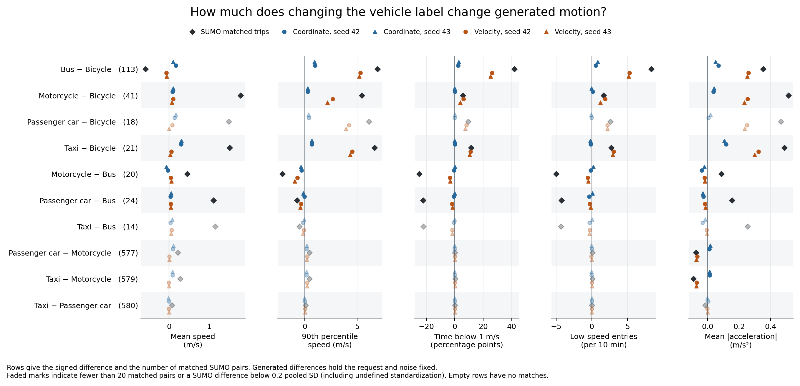
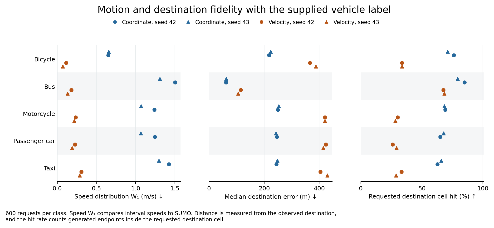
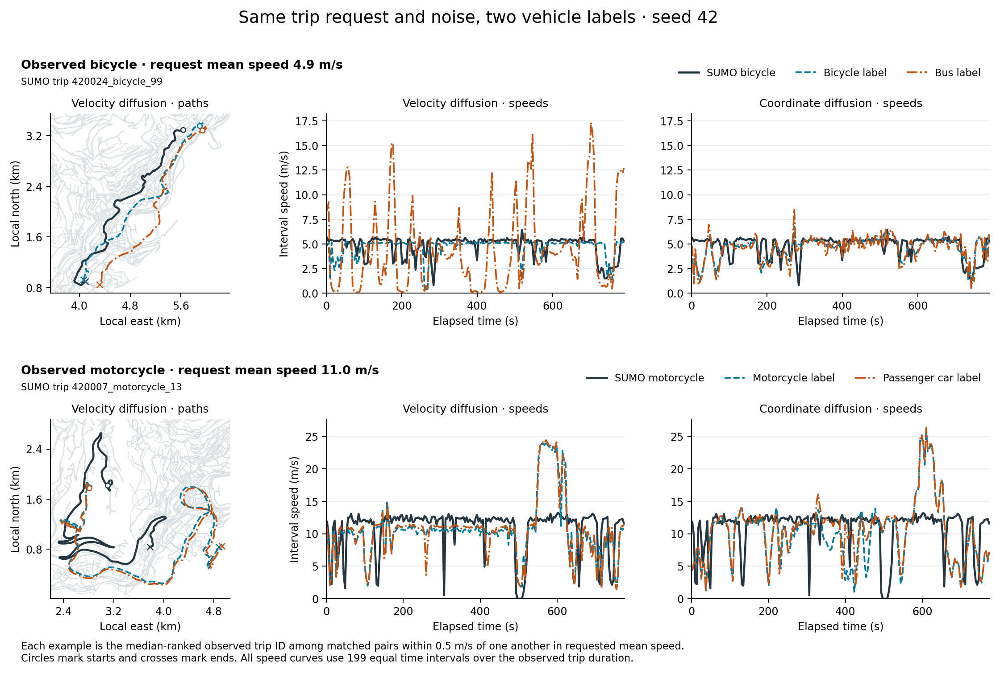

# Can a vehicle label control the motion of a generated trip?

On the five-class SUMO validation set, a model trained to generate two-dimensional velocities reproduced vehicle-specific motion more closely than an equally trained model that generated coordinates. The clearest example was a bus and a bicycle travelling at similar average speeds. Changing the label to bus made the velocity model generate more time at low speed, more decelerations into low speed and a higher cruising-speed range. Both training seeds reproduced the effect. Integrating the velocities also introduced substantial destination error.

## What changed in the experiment?

Each model saw the same 200,000 SUMO trips, with 40,000 each for bicycles, buses, motorcycles, passenger cars and taxis. Both received the same vehicle embedding and DiffTraj request, including trip-average speed, origin and destination cells, distance and duration. One model generated 200 coordinate pairs. The other generated a starting offset and 199 two-dimensional velocities. Integrating each velocity over its time interval produced the 200 positions on which we scored the model. Both models learned through the same diffusion noise-prediction loss. Each seed (42 and 43) took 9,760 optimizer updates. The final checkpoints drew trajectories for the same 3,000 validation requests, 600 per class.

We generated each supported alternative label on the **same request with the same initial noise**. The SUMO comparison used observed trips with similar requests. A SUMO bus uses a predefined route with stops, while the other classes draw from permitted origin and destination edges. The class contrast therefore includes how the class operates on this network. The filtering and sensor clock were shared by the two models. [Simulation generator](../../../experiments/difftraj/make_balanced_trips.py) · [Protocol and training commands](PROTOCOL.md)

## What changes when only the vehicle label changes?

For the closest comparison, we retained 53 bus–bicycle pairs whose requested average speeds differed by at most 0.50 m/s. The mean signed difference in requested speed (bus minus bicycle) was −0.074 m/s. A request can therefore describe similar average progress for vehicles with different stop–and–go behaviour. Every generated difference below uses exactly the same request on both sides of the subtraction.

| Bus minus bicycle | Observed SUMO difference | Coordinate model, seeds 42 / 43 | Velocity model, seeds 42 / 43 |
|---|---:|---:|---:|
| Time below 1 m/s (percentage points) | +39.6 | +2.54 / +2.90 | +26.1 / +25.1 |
| Entries into low speed per 10 minutes | +7.87 | +0.54 / +0.74 | +5.40 / +5.13 |
| 90th-percentile speed (m/s) | +7.38 | +1.00 / +0.89 | +5.35 / +5.14 |
| Mean absolute change in speed per second (m/s²) | +0.363 | +0.074 / +0.050 | +0.268 / +0.254 |

The velocity model recovered about two thirds of the observed bus–bicycle difference in low-speed time and entries. It also captured a smaller class difference. In the 253 closely matched passenger-car–motorcycle pairs, changing the label from motorcycle to passenger car reduced mean absolute acceleration by 0.070 and 0.074 m/s², compared with 0.093 m/s² in SUMO. Switching from motorcycle to taxi gave reductions of 0.079 and 0.078 m/s², compared with 0.112 m/s² in 254 observed pairs. Passenger car versus taxi had 245 pairs, with small observed differences on all four shape measures. The remaining six comparisons had at most 12 pairs after matching mean speed this closely. [Matched-pair counts and intervals](BALANCE.md)

Across five vehicle pairs with at least 30 matches under the primary matching rule, the velocity model reduced the total absolute error for P90 speed, low-speed time, entry frequency and acceleration by **59–66%** relative to predicting zero label effect. The coordinate model reduced it by **5–12%**. Differences in whole-trip mean speed changed little in either model, consistent with the supplied request. [All ten class contrasts and denominators](STATS.md)

## What happens to the generated trajectories?

With the correct vehicle label, speed-distribution error fell in every class and both training seeds. As a separate check on the value of knowing the label, we compared providing it with drawing a plausible class from similar training requests. The latter already selected the correct class for 1,826 of 3,000 requests. Providing it reduced velocity-model speed W1 by a further 0.024 / 0.038 m/s and acceleration W1 by 0.016 / 0.014 m/s. This comparison measures the incremental value of the actual label at sampling time. Both models were trained with labels.

| Across five classes, equally weighted | Coordinate, seeds 42 / 43 | Velocity, seeds 42 / 43 |
|---|---:|---:|
| Speed W1 (m/s), lower is better | 1.213 / 1.080 | 0.212 / 0.179 |
| Acceleration W1 (m/s²), lower is better | 0.181 / 0.190 | 0.027 / 0.032 |
| Points density JS, lower is better | 0.0077 / 0.0078 | 0.0371 / 0.0408 |
| Origin–destination JS, lower is better | 0.2357 / 0.2448 | 0.3398 / 0.3470 |
| Trip length JS, lower is better | 0.0310 / 0.0253 | 0.0213 / 0.0112 |
| Top-20 hotspot F1, higher is better | 0.950 / 0.930 | 0.800 / 0.820 |
| End in requested cell, higher is better | 71.7% / 70.5% | 38.2% / 37.7% |

Speed is the distance travelled between consecutive positions divided by the actual interval duration. A low-speed entry crosses below 1 m/s and persists for at least two sampled intervals. Each observed and generated trip uses the same 200-point time resolution for motion comparisons. In the four distribution metrics, the observed reference uses the native one-second SUMO positions. W1 is the first Wasserstein distance and is reported in physical units.

The paired maps show why both types of evidence matter. In the first row below, the bicycle request specifies a mean of 4.9 m/s. The velocity model produces a relatively steady speed under the bicycle label. With the bus label it alternates between near-zero speeds and faster travel. The coordinate model yields similar speed curves for these two labels. In the second row, a change between two motorized classes produces a subtler response. Net displacement still depends on the sum of the generated velocity vectors, and the maps show how similar speed profiles can accompany different paths. We selected each illustrated request by median trip-ID rank among eligible matches before inspecting the draws.

[Same requests, independent training seed 43](trips-43.png) · [Per-class metrics, two-seed comparisons and fingerprints](STATS.md)

The result supports vehicle control over the **within-trip speed profile** under the supplied request. Its practical benefit is strongest where the SUMO observations exhibit a clear class difference. For a generator that must also reach a requested destination, the spatial accuracy of the coordinate model remains the reference to match.
