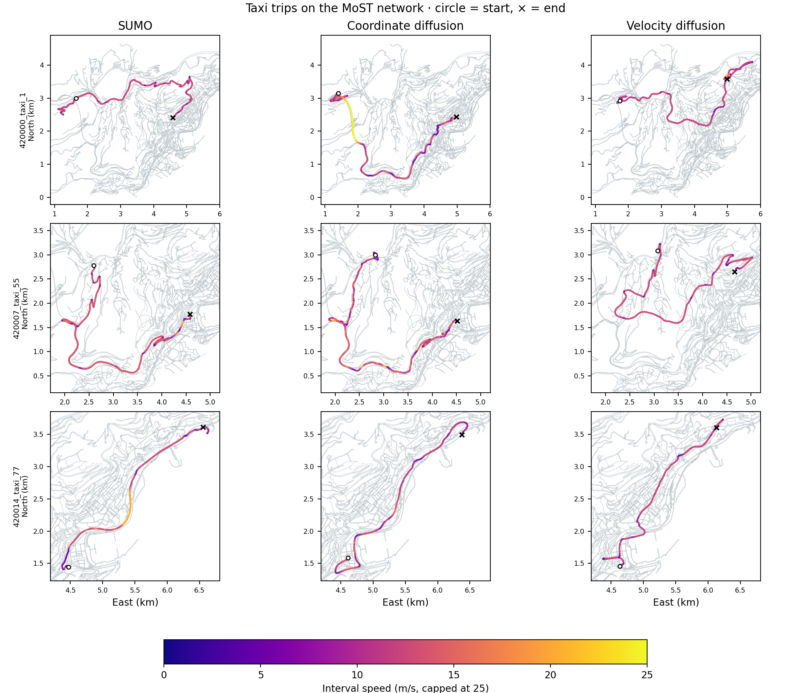
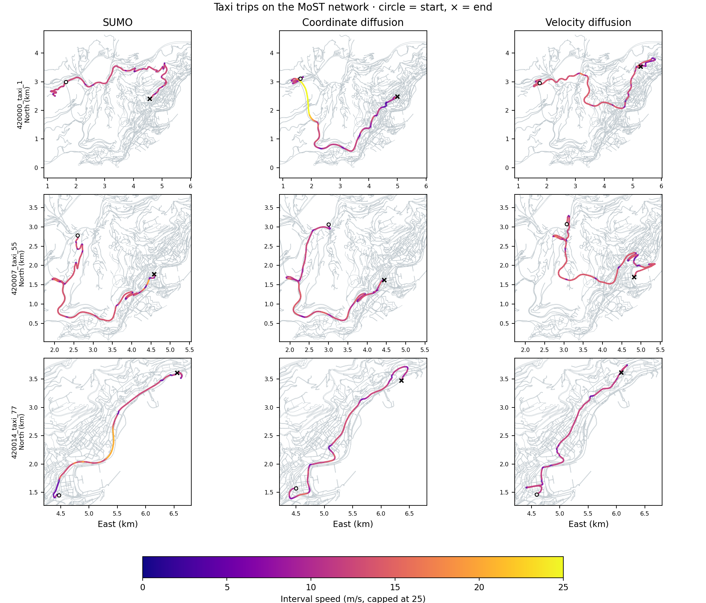

# Taxi validation results

Paired free draws for 1,000 taxi requests per checkpoint. Location errors are measured against a paired observed trip, while cell hit rates are measured against the request. The original request provides cells, not precise endpoints. Both representations generate their own start position. A single coordinate model may take a different legitimate route from its paired observation.

| Representation | Seed | Speed W1, m/s | Acceleration W1, m/s² | Length W1, m | Start error, median m | End error, median m | Displacement-vector error, median m | Start+end cells hit |
|---|---:|---:|---:|---:|---:|---:|---:|---:|
| coordinate | 42 | 1.183 | 0.386 | 374.766 | 236.249 | 235.555 | 331.608 | 0.542 |
| coordinate | 43 | 1.173 | 0.233 | 453.676 | 228.013 | 229.049 | 330.345 | 0.538 |
| velocity | 42 | 0.160 | 0.030 | 159.634 | 247.124 | 409.673 | 380.956 | 0.281 |
| velocity | 43 | 0.203 | 0.033 | 170.195 | 245.859 | 411.519 | 398.686 | 0.301 |

| Representation | Seed | Density JS | OD JS | Length JS | Hotspot F1 | Out-of-bounds fraction |
|---|---:|---:|---:|---:|---:|---:|
| coordinate | 42 | 0.00506 | 0.24658 | 0.00812 | 1.00000 | 0.00091 |
| coordinate | 43 | 0.00507 | 0.24948 | 0.00912 | 1.00000 | 0.00089 |
| velocity | 42 | 0.03994 | 0.38874 | 0.00263 | 0.80000 | 0.00450 |
| velocity | 43 | 0.04135 | 0.39019 | 0.00305 | 0.80000 | 0.00663 |

The representation is numerically invertible (maximum coordinate reconstruction error below 0.00006 m). Integrated generated trajectories substantially improve speed, acceleration and journey-length distributions at both seeds. The destination-cell hit rate falls from 72.6/73.1% to 31.1/32.6%, while the initial cell hit rate rises from 73.9/73.9% to 86.3/89.0%. Median paired destination error rises to 410/412 m. Estimated net-displacement bearing error has a median of 4.91/5.30 degrees in the velocity runs. The spatial and endpoint degradation precludes a direct class-labelled scale-up under the initial protocol. A subsequent single-class comparison could encode the generated trip-level displacement separately from the within-trip velocity variations, using only the supplied endpoint cells at inference. A better speed distribution on taxis alone does not establish a vehicle-class effect.
