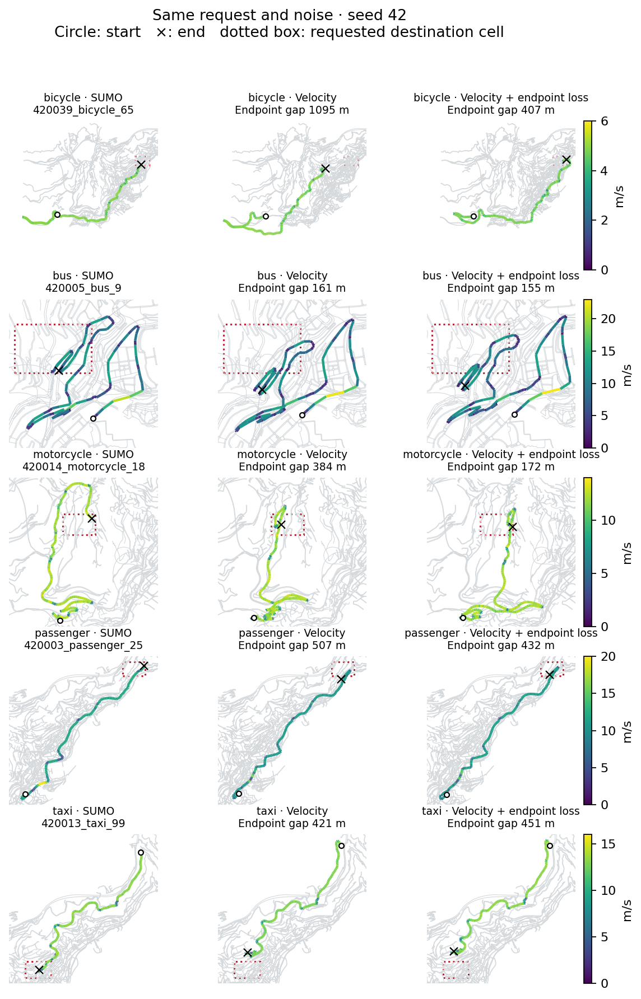
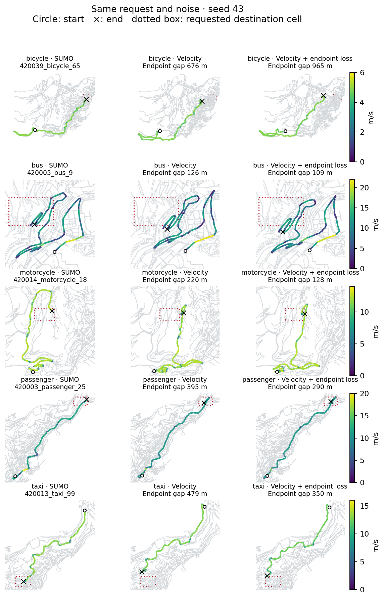

# Integrated endpoint loss on five-class SUMO trips

Validation uses 3,000 common requests, 600 per class, one fixed draw per request with the supplied label. Across-class metrics weight all classes equally. Columns give the original velocity generator and the same generator trained with the extra integrated endpoint loss. The weight is 0.1 for both seeds. [Loss definition and comparison protocol](PROTOCOL.md).

| Measure | Original 42 | Endpoint 42 | Original 43 | Endpoint 43 |
|---|---:|---:|---:|---:|
| Requested destination hit | 38.2% | 47.6% | 37.7% | 48.6% |
| Both requested cells hit | 34.8% | 43.6% | 34.4% | 45.3% |
| Speed W1 (m/s) | 0.212 | 0.177 | 0.179 | 0.221 |
| Acceleration W1 (m/s²) | 0.027 | 0.029 | 0.032 | 0.037 |
| Density JS | 0.0371 | 0.0345 | 0.0408 | 0.0336 |
| OD JS | 0.3398 | 0.2943 | 0.3470 | 0.2802 |
| Length JS | 0.0213 | 0.0151 | 0.0112 | 0.0140 |
| Hotspot F1 | 0.800 | 0.810 | 0.820 | 0.820 |
| Median paired end error (m) | 341.8 | 290.8 | 349.7 | 281.7 |
| Median net bearing error (degrees) | 4.08 | 3.82 | 4.18 | 3.65 |
| Median absolute net displacement length error (m) | 194.4 | 160.0 | 185.5 | 158.9 |

## Holding request and noise fixed, switch bicycle to bus

Observed reference compares 53 matched SUMO trip pairs whose requested mean speeds differ by at most 0.5 m/s. The generated change switches the label at each identical header and noise. Entries count intervals crossing below 1 m/s and remaining below for at least two intervals. Time share is in percentage points.

| Bus minus bicycle | SUMO | Original 42 | Endpoint 42 | Original 43 | Endpoint 43 |
|---|---:|---:|---:|---:|---:|
| Low-speed share (pp) | 39.623 | 26.083 | 24.073 | 25.092 | 22.452 |
| Low-speed entries / 10 min | 7.874 | 5.399 | 4.908 | 5.131 | 4.574 |
| 90th-percentile speed (m/s) | 7.382 | 5.350 | 5.149 | 5.144 | 4.592 |
| Mean absolute acceleration (m/s²) | 0.363 | 0.268 | 0.253 | 0.254 | 0.224 |

## By vehicle class

| Class | Seed | Destination hit, original → endpoint | Median end error (m) | Speed W1 (m/s) |
|---|---:|---:|---:|---:|
| bicycle | 42 | 33.7% → 48.5% | 366 → 308 | 0.113 → 0.068 |
| bicycle | 43 | 33.8% → 49.0% | 387 → 309 | 0.071 → 0.073 |
| bus | 42 | 67.7% → 70.7% | 115 → 94 | 0.181 → 0.163 |
| bus | 43 | 68.3% → 71.5% | 106 → 90 | 0.133 → 0.134 |
| motorcycle | 42 | 30.2% → 42.0% | 420 → 366 | 0.235 → 0.203 |
| motorcycle | 43 | 28.3% → 38.8% | 421 → 359 | 0.216 → 0.290 |
| passenger | 42 | 26.2% → 37.7% | 424 → 351 | 0.224 → 0.189 |
| passenger | 43 | 29.3% → 40.2% | 414 → 334 | 0.188 → 0.261 |
| taxi | 42 | 33.3% → 39.3% | 404 → 360 | 0.308 → 0.263 |
| taxi | 43 | 28.8% → 43.5% | 429 → 339 | 0.286 → 0.347 |

The same first validation request per class is plotted at both training seeds. The dotted box is the requested destination cell. Colours give speed on a shared scale within each request. Distance annotations compare the generated endpoint to the paired observation.

